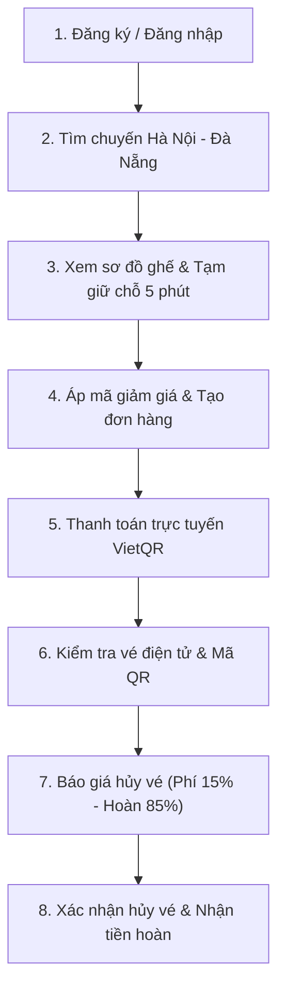
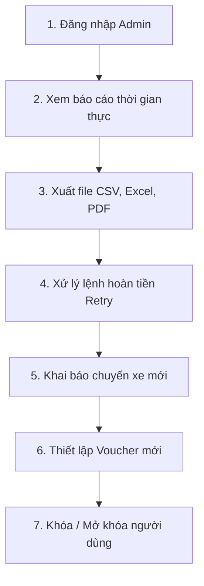
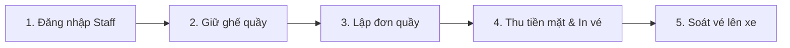

# HƯỚNG DẪN TEST TAY & KIỂM THỬ TOÀN DIỆN HỆ THỐNG API VÉ XE KHÁCH

Tài liệu này cung cấp hướng dẫn chi tiết cách kiểm thử thủ công (manual testing), tích hợp API và chạy các kịch bản nghiệp vụ thực tế trên hệ thống **Vé Xe Khách (OOAD Bus Ticket System)** thông qua:
1. **Swagger UI** trực quan tại trình duyệt.
2. **Postman Collection v2.1** chuẩn hóa đi kèm file `Vexe_API_Collection.postman_collection.json`.

---

## 1. THÔNG TIN HỆ THỐNG & TÀI KHOẢN THỬ NGHIỆM

### 1.1 Địa chỉ dịch vụ (Endpoints)
- **Base URL API**: `http://localhost:8005` (hoặc `http://localhost:8005/api`)
- **Tài liệu Swagger UI**: `http://localhost:8005/docs`
- **Tài liệu ReDoc**: `http://localhost:8005/redoc`
- **OpenAPI Schema (JSON)**: `http://localhost:8005/openapi.json`
- **Health Check**: `http://localhost:8005/health`

*(Lưu ý: Nếu bạn chạy qua cổng khác được cấu hình trong `docker-compose.yml` như `8000` hoặc `8001`, hãy thay thế cổng tương ứng).*

---

### 1.2 Danh sách tài khoản thử nghiệm có sẵn (Seeded Accounts)
Cơ sở dữ liệu đã nạp sẵn các tài khoản demo chuẩn với dữ liệu hoạt động thực tế:

| Số điện thoại | Mật khẩu | Vai trò (`Role`) | Họ và tên | Mục đích sử dụng |
| :--- | :--- | :--- | :--- | :--- |
| `0900000000` | `Admin12345` | **ADMIN** | Quản trị viên | Toàn quyền cấu hình hệ thống, xem báo cáo, duyệt hoàn tiền, quản lý xe/tuyến/chuyến |
| `0900000001` | `Staff12345` | **NHAN_VIEN_BAN_VE** | Nhân viên quầy Mỹ Đình | Bán vé tại quầy, thu tiền mặt, in vé, hủy vé quầy, soát vé lên xe |
| `0900000003` | `Staff12345` | **NHAN_VIEN_BAN_VE** | Nhân viên quầy Miền Đông | Bán vé, đối soát doanh thu quầy ca trực |
| `0900000002` | `Khach12345` | **KHACH_HANG** | Nguyễn Văn An | Khách hàng online, đã có lịch sử đơn hàng và vé xe |
| `0900000010` | `Khach12345` | **KHACH_HANG** | Trần Thị Bình | Khách hàng online (đã có vé thanh toán VietQR) |
| `0900000012` | `Khach12345` | **KHACH_HANG** | Phạm Minh Đức | Khách hàng có lệnh hủy vé lỗi chờ Admin duyệt (`fail_refund`) |
| `0900000014` | `Khach12345` | **KHACH_HANG** | Đặng Quốc Phong | Khách hàng online |

---

## 2. HƯỚNG DẪN TEST QUA SWAGGER UI (`/docs`)

Swagger UI cho phép chạy thử trực tiếp mọi endpoint mà không cần cài thêm công cụ ngoài trình duyệt.

```
+-------------------------------------------------------------------------------+
|  OOAD Bus Ticket API - Swagger UI                       [ Authorize  🔓 ]     |
|  http://localhost:8005/docs                                                   |
+-------------------------------------------------------------------------------+
|  ▼ auth                                                                       |
|    POST  /auth/login            Đăng nhập lấy token                           |
|  ▼ tra cứu chuyến xe                                                          |
|    GET   /trips/search          Tìm chuyến xe                                 |
|  ▼ admin: thống kê & báo cáo                                                  |
|    GET   /admin/reports         Báo cáo doanh thu thời gian thực              |
+-------------------------------------------------------------------------------+
```

### Bước 1: Mở Swagger UI
Mở trình duyệt web và truy cập địa chỉ:
```
http://localhost:8005/docs
```

### Bước 2: Đăng nhập lấy Bearer Token
1. Cuộn đến nhóm endpoint **`auth`**.
2. Bấm mở `POST /auth/login`.
3. Bấm nút **Try it out**.
4. Điền Request Body tương ứng:
   - **Đăng nhập Admin**:
     ```json
     {
       "phone": "0900000000",
       "password": "Admin12345"
     }
     ```
   - **Đăng nhập Khách hàng**:
     ```json
     {
       "phone": "0900000002",
       "password": "Khach12345"
     }
     ```
5. Bấm **Execute**.
6. Tại phần **Response body**, copy toàn bộ chuỗi token trong giá trị của trường `"access_token"` (không bao gồm dấu ngoặc kép).

### Bước 3: Xác thực qua nút Authorize (Ổ khóa)
1. Kéo lên góc trên bên phải màn hình Swagger UI, bấm vào nút **Authorize** (biểu tượng ổ khóa màu xanh).
2. Một hộp thoại popup **Available authorizations** sẽ hiện ra.
3. Tại ô **Value**, điền:
   ```
   Bearer <chuỗi_access_token_vừa_copy>
   ```
   *(Ví dụ: `Bearer eyJhbGciOiJIUzI1NiIsInR5cCI6IkpXVCJ9...`)*.
4. Bấm **Authorize**, sau đó bấm **Close**. Biểu tượng ổ khóa sẽ chuyển sang trạng thái đã khóa (locked 🔒).
5. Từ lúc này, mọi request yêu cầu quyền hạn tương ứng với token sẽ tự động được đính kèm Header `Authorization: Bearer <token>`.

---

## 3. HƯỚNG DẪN IMPORT & SỬ DỤNG POSTMAN COLLECTION

Hệ thống đã chuẩn bị sẵn bộ sưu tập Postman chuẩn hóa v2.1 đầy đủ 79 requests đặt tại root dự án:
```
Vexe_API_Collection.postman_collection.json
```

### 3.1 Các bước Import vào Postman
1. Khởi động ứng dụng **Postman**.
2. Chọn không gian làm việc (**My Workspace** hoặc tạo Workspace mới).
3. Bấm vào nút **Import** ở thanh bên trái phía trên (hoặc phím tắt `Ctrl + O` / `Cmd + O`).
4. Kéo thả file `Vexe_API_Collection.postman_collection.json` vào cửa sổ Import hoặc bấm **Browse files** và trỏ đến file trong thư mục dự án.
5. Bấm **Import**. Bộ sưu tập mang tên **`Vé Xe Khách - API Collection`** sẽ xuất hiện trong danh sách Collections.

---

### 3.2 Cấu trúc 13 Folder trong Collection

```
Vé Xe Khách - API Collection
├── 📁 Folder 01: Authentication (13 API - Đăng nhập Admin/Customer/Staff, Đăng ký OTP, Me, Reset pass...)
├── 📁 Folder 02: Tra cứu & Chọn chuyến (4 API - Tìm chuyến, Tuyến xe, Chi tiết chuyến, Sơ đồ ghế)
├── 📁 Folder 03: Tạm giữ chỗ (3 API - Khóa ghế 5 phút, Xem ghế đang giữ, Nhả ghế)
├── 📁 Folder 04: Đặt vé & Thanh toán (8 API - Kiểm tra voucher, Tạo đơn, Thanh toán VietQR/MoMo, Webhook)
├── 📁 Folder 05: Vé & Hủy vé (4 API - Lịch sử vé, Chi tiết vé điện tử/QR, Báo giá hủy, Hủy vé trực tuyến)
├── 📁 Folder 06: Quầy vé & Soát vé (6 API - Bán vé quầy, In vé giấy, Hủy vé tại quầy, Soát vé lên xe)
├── 📁 Folder 07: Admin - Báo cáo & Doanh thu (4 API - Doanh thu JSON, Xuất CSV, Xuất XLSX, Xuất PDF)
├── 📁 Folder 08: Admin - Đơn hàng & Hoàn tiền (4 API - Danh sách đơn, Chi tiết đơn, Hàng đợi hoàn tiền, Retry)
├── 📁 Folder 09: Admin - Lộ trình & Chuyến xe (8 API - Quản lý tuyến, Tạo chuyến, Đổi giờ báo SMS, Hủy chuyến 100%)
├── 📁 Folder 10: Admin - Đội xe & Sơ đồ ghế (9 API - Loại xe, Danh sách xe, Thêm xe + Layout, Đổi sơ đồ)
├── 📁 Folder 11: Admin - Khuyến mãi & Voucher (3 API - Danh sách voucher, Tạo mã mới, Bật/Tắt)
├── 📁 Folder 12: Admin - Người dùng & Bảo mật (7 API - Danh sách tài khoản, Tạo nhân viên, Khóa/Mở khóa, Audit)
├── 📁 Folder 13: Admin - Cấu hình hệ thống (5 API - Xem tham số, Đổi thời gian giữ chỗ, phí hủy, OTP...)
└── ⚡ 00 - Kiểm tra sức khỏe hệ thống (Health Check)
```

---

### 3.3 Cơ chế tự động hóa biến Collection (Collection Variables)
Bộ sưu tập được cấu hình tự động trích xuất và kế thừa token, loại bỏ thao tác copy-paste thủ công:

| Tên biến | Giá trị mặc định | Mô tả & Cơ chế tự động |
| :--- | :--- | :--- |
| `baseUrl` | `http://localhost:8005` | Địa chỉ máy chủ API backend |
| `admin_token` | *(Tự động điền)* | Tự lưu khi chạy request `01 - Đăng nhập Quản trị viên (Admin)` |
| `customer_token` | *(Tự động điền)* | Tự lưu khi chạy request `02 - Đăng nhập Khách hàng (Customer)` |
| `staff_token` | *(Tự động điền)* | Tự lưu khi chạy request `03 - Đăng nhập Nhân viên quầy (Staff)` |
| `last_otp` | `123456` | Tự bắt mã OTP từ trường `mock_otp` khi gọi API gửi OTP |
| `trip_id` | `1` | Tự cập nhật ID chuyến xe khi gọi tìm chuyến hoặc tạo chuyến |
| `order_id` | `1` | Tự cập nhật ID đơn hàng vừa tạo |
| `ticket_id` | `1` | Tự cập nhật ID vé xe vừa tạo hoặc từ danh sách vé |

> [!TIP]
> **Chỉ cần chạy 3 request đầu tiên trong `Folder 01: Authentication`**, bạn sẽ sở hữu đầy đủ 3 token cho 3 vai trò và sẵn sàng thực thi toàn bộ 79 API!

---

## 4. KỊCH BẢN TEST TAY 1: LUỒNG TRỌN VẸN KHÁCH HÀNG (CUSTOMER E2E)

Kịch bản này mô phỏng hành trình hoàn chỉnh của hành khách: **Đăng ký / Đăng nhập -> Tra cứu chuyến -> Giữ chỗ 5 phút -> Áp voucher -> Đặt vé -> Thanh toán VietQR -> Tra cứu vé điện tử -> Báo giá hủy vé & Hủy vé nhận hoàn tiền 85%**.



### Bước 1.1: Đăng nhập tài khoản Khách hàng
- **Postman Request**: `Folder 01: Authentication` -> `02 - Đăng nhập Khách hàng (Customer)`
- **Method & URL**: `POST {{baseUrl}}/auth/login`
- **Request Body**:
  ```json
  {
    "phone": "0900000002",
    "password": "Khach12345"
  }
  ```
- **Kết quả mong đợi**: HTTP 200 OK. Biến `{{customer_token}}` được tự động cập nhật trong Collection.

---

### Bước 1.2: Tra cứu chuyến xe
- **Postman Request**: `Folder 02: Tra cứu & Chọn chuyến` -> `01 - Tìm chuyến xe (Search Trips)`
- **Method & URL**:
  ```
  GET {{baseUrl}}/trips/search?origin=Hà Nội&destination=Đà Nẵng&date=2026-11-15&min_price=100000&max_price=600000
  ```
- **Kết quả mong đợi**: HTTP 200 OK. Trả về danh sách chuyến xe phù hợp. Biến `{{trip_id}}` được gán vào chuyến xe tìm thấy (ví dụ: `trip_id = 1`).

---

### Bước 1.3: Xem sơ đồ ghế của chuyến xe
- **Postman Request**: `Folder 02: Tra cứu & Chọn chuyến` -> `04 - Xem sơ đồ ghế & Trạng thái chỗ`
- **Method & URL**: `GET {{baseUrl}}/trips/{{trip_id}}/seats`
- **Kết quả mong đợi**: HTTP 200 OK. Trả về danh sách ghế kèm trạng thái:
  - `TRONG`: Ghế còn trống, có thể chọn.
  - `TAM_KHOA`: Ghế đang bị người khác giữ chỗ.
  - `DA_BAN`: Ghế đã thanh toán.
- **Chọn ghế**: Chọn 1 ghế có trạng thái `TRONG` (ví dụ `seat_id: 1` hoặc `seat_id: 2`).

---

### Bước 1.4: Tạm giữ chỗ 5 phút (Hold Seats)
- **Postman Request**: `Folder 03: Tạm giữ chỗ` -> `01 - Tạm giữ ghế 5 phút (Hold Seats)`
- **Method & URL**: `POST {{baseUrl}}/trips/{{trip_id}}/hold`
- **Headers**: `Authorization: Bearer {{customer_token}}`
- **Request Body**:
  ```json
  {
    "seat_ids": [1]
  }
  ```
- **Kết quả mong đợi**: HTTP 200 OK.
  - `seconds_left`: xấp xỉ `300` (5 phút đếm ngược).
  - Ghế này ngay lập tức chuyển sang trạng thái `TAM_KHOA` đối với tất cả người dùng khác.

---

### Bước 1.5: Kiểm tra tính hợp lệ của mã giảm giá (Validate Coupon)
- **Postman Request**: `Folder 04: Đặt vé & Thanh toán` -> `01 - Kiểm tra mã giảm giá (Validate Coupon)`
- **Method & URL**: `POST {{baseUrl}}/coupons/validate`
- **Headers**: `Authorization: Bearer {{customer_token}}`
- **Request Body**:
  ```json
  {
    "code": "CHAOBAN",
    "amount": 450000
  }
  ```
- **Kết quả mong đợi**: HTTP 200 OK.
  - Giảm giá 10% (tối đa 50.000đ): `discount = 45000.0`.
  - Số tiền thanh toán cuối cùng: `final_amount = 405000.0`.

---

### Bước 1.6: Tạo đơn hàng đặt vé (Create Order)
- **Postman Request**: `Folder 04: Đặt vé & Thanh toán` -> `02 - Tạo đơn hàng đặt vé (Create Order)`
- **Method & URL**: `POST {{baseUrl}}/orders`
- **Headers**: `Authorization: Bearer {{customer_token}}`
- **Request Body**:
  ```json
  {
    "trip_id": 1,
    "items": [
      {
        "seat_id": 1,
        "passenger_name": "Nguyễn Văn An",
        "passenger_phone": "0900000002",
        "pickup_stop_id": null,
        "dropoff_stop_id": null
      }
    ],
    "coupon_code": "CHAOBAN"
  }
  ```
- **Kết quả mong đợi**: HTTP 201 Created.
  - Trạng thái đơn hàng: `"CHO_THANH_TOAN"`.
  - Biến `{{order_id}}` và `{{ticket_id}}` được tự động lưu.

---

### Bước 1.7: Thanh toán đơn hàng qua VietQR
- **Postman Request**: `Folder 04: Đặt vé & Thanh toán` -> `05 - Thanh toán đơn hàng qua VietQR (Giả lập QR)`
- **Method & URL**: `POST {{baseUrl}}/orders/{{order_id}}/pay`
- **Headers**: `Authorization: Bearer {{customer_token}}`
- **Request Body**:
  ```json
  {
    "method": "VIETQR",
    "simulate": "success"
  }
  ```
- **Kết quả mong đợi**: HTTP 200 OK.
  - `result`: `"THANH_CONG"`.
  - `order.status`: `"DA_THANH_TOAN"`.
  - Vé chuyển sang trạng thái: `"CHUA_DI"`.

---

### Bước 1.8: Kiểm tra lịch sử vé & Chi tiết vé điện tử
- **Postman Request**: `Folder 05: Vé & Hủy vé` -> `01 - Lịch sử vé của tôi`
- **Method & URL**: `GET {{baseUrl}}/me/tickets?status=CHUA_DI`
- **Headers**: `Authorization: Bearer {{customer_token}}`
- **Kết quả mong đợi**: HTTP 200 OK.
  - Thấy vé xe vừa đặt hiển thị mã QR soát vé, biển số xe, ngày giờ xuất bến.

---

### Bước 1.9: Báo giá hủy vé (Quote Cancellation)
- **Postman Request**: `Folder 05: Vé & Hủy vé` -> `03 - Báo giá hủy vé (Xem trước phí 15%)`
- **Method & URL**: `GET {{baseUrl}}/tickets/{{ticket_id}}/cancel-quote`
- **Headers**: `Authorization: Bearer {{customer_token}}`
- **Kết quả mong đợi**: HTTP 200 OK.
  ```json
  {
    "can_cancel": true,
    "reason": null,
    "hours_left": 72.5,
    "fee_percent": 15,
    "fee": 60750.0,
    "refund_amount": 344250.0,
    "refund_method": "VIETQR"
  }
  ```
  *(Giải thích: Thời gian trước giờ khởi hành > 24 giờ đủ điều kiện hủy vé; phí hủy là 15%, khách hàng nhận lại 85% qua tài khoản ban đầu).*

---

### Bước 1.10: Xác nhận hủy vé trực tuyến
- **Postman Request**: `Folder 05: Vé & Hủy vé` -> `04 - Xác nhận hủy vé trực tuyến (Hoàn tiền 85%)`
- **Method & URL**: `POST {{baseUrl}}/tickets/{{ticket_id}}/cancel`
- **Headers**: `Authorization: Bearer {{customer_token}}`
- **Request Body**:
  ```json
  {
    "simulate": null
  }
  ```
- **Kết quả mong đợi**: HTTP 200 OK.
  - `status`: `"THANH_CONG"`.
  - Ghế lập tức được giải phóng trở lại trạng thái `TRONG`.
  - Vé chuyển trạng thái sang `DA_HUY`.

---

## 5. KỊCH BẢN TEST TAY 2: LUỒNG QUẢN TRỊ VIÊN ADMIN (ADMIN MANAGEMENT)

Kịch bản này kiểm tra các tác vụ trọng yếu của Quản trị viên: **Đăng nhập Admin -> Xem & Xuất báo cáo tài chính -> Xử lý lệnh hoàn tiền lỗi -> Thêm chuyến xe mới -> Cấu hình voucher khuyến mãi -> Khóa/Mở khóa tài khoản**.



### Bước 2.1: Đăng nhập tài khoản Quản trị viên
- **Postman Request**: `Folder 01: Authentication` -> `01 - Đăng nhập Quản trị viên (Admin)`
- **Method & URL**: `POST {{baseUrl}}/auth/login`
- **Request Body**:
  ```json
  {
    "phone": "0900000000",
    "password": "Admin12345"
  }
  ```
- **Kết quả mong đợi**: HTTP 200 OK. Biến `{{admin_token}}` được tự động ghi đè.

---

### Bước 2.2: Xem Báo cáo Doanh thu & Tỷ lệ lấp đầy
- **Postman Request**: `Folder 07: Admin - Báo cáo & Doanh thu` -> `01 - Báo cáo doanh thu & lấp đầy (JSON)`
- **Method & URL**:
  ```
  GET {{baseUrl}}/admin/reports?date_from=2026-11-01&date_to=2026-11-30
  ```
- **Headers**: `Authorization: Bearer {{admin_token}}`
- **Kết quả mong đợi**: HTTP 200 OK.
  - `gross`: Doanh thu gộp ban đầu.
  - `refunded`: Tổng tiền đã hoàn trả cho các vé hủy.
  - `net`: Doanh thu thuần (`gross - refunded`).
  - `cancel_rate`: Tỷ lệ hủy vé.
  - `occupancy`: Tỷ lệ lấp đầy ghế bình quân toàn mạng lưới.
  - `by_route`: Chi tiết phân bổ doanh thu theo từng tuyến đường.

---

### Bước 2.3: Xuất báo cáo ra File CSV, Excel, PDF
Thực thi tuần tự 3 requests xuất báo cáo:
1. `02 - Xuất báo cáo doanh thu ra CSV`:
   - URL: `GET {{baseUrl}}/admin/reports/export.csv?date_from=2026-11-01&date_to=2026-11-30`
   - Kiểm tra Header phản hồi: `Content-Type: text/csv; charset=utf-8` và file tải về có UTF-8 BOM hiển thị chuẩn tiếng Việt.
2. `03 - Xuất báo cáo doanh thu ra Excel (XLSX)`:
   - URL: `GET {{baseUrl}}/admin/reports/export.xlsx?date_from=2026-11-01&date_to=2026-11-30`
   - Nhận file nhị phân bảng tính Excel 2 sheet.
3. `04 - Xuất báo cáo doanh thu ra PDF (Khổ A4)`:
   - URL: `GET {{baseUrl}}/admin/reports/export.pdf?date_from=2026-11-01&date_to=2026-11-30`
   - Nhận file tài liệu PDF khổ A4 ngang chuẩn chỉ.

---

### Bước 2.4: Phê duyệt / Xử lý lại lệnh hoàn tiền thủ công (Refund Retry)
Hệ thống có cơ chế hàng đợi hoàn tiền: Khi cổng thanh toán từ chối hoàn tự động, lệnh sẽ được đưa vào hàng đợi `CHO_XU_LY_THU_CONG` để Admin kiểm tra và duyệt lại.
- **Xem hàng đợi**: `Folder 08: Admin - Đơn hàng & Hoàn tiền` -> `03 - Danh sách lệnh hoàn tiền (Hàng đợi)`
  - URL: `GET {{baseUrl}}/admin/refunds?status=CHO_XU_LY_THU_CONG`
  - Thấy lệnh hoàn tiền của khách hàng `0900000012` (ID hoàn tiền thường là `1` hoặc `2`).
- **Phê duyệt hoàn tiền (Retry)**: `04 - Phê duyệt / Thử lại lệnh hoàn tiền (Retry)`
  - URL: `POST {{baseUrl}}/admin/refunds/1/retry`
  - Request Body:
    ```json
    {
      "simulate": "success"
    }
    ```
  - **Kết quả**: HTTP 200 OK. Lệnh hoàn tiền chuyển sang `THANH_CONG`, giải tỏa hàng đợi.

---

### Bước 2.5: Thêm chuyến xe mới & Điều chỉnh giá vé
1. **Tạo chuyến xe mới**: `Folder 09: Admin - Lộ trình & Chuyến xe` -> `05 - Tạo chuyến xe mới`
   - URL: `POST {{baseUrl}}/admin/trips`
   - Request Body:
     ```json
     {
       "route_id": 1,
       "vehicle_id": 1,
       "departure_date": "2026-11-25",
       "departure_time": "20:00:00",
       "price": 450000,
       "pickup_points": ["Bến xe Giáp Bát", "Bến xe Mỹ Đình"],
       "dropoff_points": ["Bến xe Trung tâm Đà Nẵng"],
       "note": "Chuyến tăng cường phục vụ du lịch"
     }
     ```
   - **Kết quả**: HTTP 201 Created. Chuyến xe có trạng thái `"MO_BAN"`.
2. **Cập nhật giá vé**: `07 - Cập nhật giá vé chuyến xe`
   - URL: `PATCH {{baseUrl}}/admin/trips/1/price`
   - Request Body: `{"price": 480000}`
   - **Kết quả**: HTTP 200 OK. Giá vé mới được cập nhật.

---

### Bước 2.6: Cấu hình mã Voucher khuyến mãi
- **Postman Request**: `Folder 11: Admin - Khuyến mãi & Voucher` -> `02 - Tạo voucher khuyến mãi mới`
- **Method & URL**: `POST {{baseUrl}}/admin/coupons`
- **Headers**: `Authorization: Bearer {{admin_token}}`
- **Request Body**:
  ```json
  {
    "code": "UUDAI100",
    "kind": "SO_TIEN",
    "value": 100000,
    "max_discount": null,
    "min_order": 500000,
    "quantity": 50,
    "valid_from": "2026-11-01T00:00:00",
    "valid_to": "2026-12-31T23:59:59",
    "description": "Giảm ngay 100k cho đơn từ 500k"
  }
  ```
- **Kết quả mong đợi**: HTTP 201 Created. Mã voucher sẵn sàng áp dụng.

---

### Bước 2.7: Quản trị tài khoản & Khóa/Mở khóa người dùng
1. **Khóa tài khoản**: `Folder 12: Admin - Người dùng & Bảo mật` -> `06 - Khóa tài khoản`
   - URL: `POST {{baseUrl}}/admin/users/2/lock`
   - **Kết quả**: HTTP 200 OK.
   - `status`: `"KHOA"`.
   - Nếu tài khoản còn vé chưa khởi hành (`CHUA_DI`), hệ thống sẽ trả kèm thông điệp cảnh báo `warning`.
2. **Kiểm tra khi bị khóa**: Thử dùng tài khoản này gọi API Đặt vé hoặc Đăng nhập -> Sẽ nhận HTTP 403 Forbidden ("Tài khoản đã bị khóa").
3. **Mở khóa tài khoản**: `07 - Mở khóa tài khoản`
   - URL: `POST {{baseUrl}}/admin/users/2/unlock`
   - **Kết quả**: HTTP 200 OK. Trạng thái trở về `"HOAT_DONG"`.

---

## 6. KỊCH BẢN BỔ TRỢ: NHÂN VIÊN BÁN VÉ TẠI QUẦY & SOÁT VÉ (STAFF POS)

Kịch bản dành cho nhân viên nhà xe: Bán vé trực tiếp cho khách vãng lai, thu tiền mặt, in vé giấy và soát vé khách khi lên xe.



### Bước 3.1: Đăng nhập tài khoản Nhân viên quầy
- **Postman Request**: `Folder 01: Authentication` -> `03 - Đăng nhập Nhân viên quầy (Staff)`
- **Request Body**:
  ```json
  {
    "phone": "0900000001",
    "password": "Staff12345"
  }
  ```
- **Kết quả**: Tự lưu `staff_token`.

### Bước 3.2: Bán vé và in biên nhận tại quầy
1. **Giữ chỗ**: `Folder 03` -> `POST /trips/1/hold` với `seat_ids: [4]` (dùng `{{staff_token}}`).
2. **Tạo đơn quầy**: `Folder 06` -> `POST /counter/orders`:
   ```json
   {
     "trip_id": 1,
     "items": [
       {
         "seat_id": 4,
         "passenger_name": "Khách Vãng Lai Bác Ba",
         "passenger_phone": "0918123456",
         "pickup_stop_id": null,
         "dropoff_stop_id": null
       }
     ],
     "coupon_code": null
   }
   ```
3. **Thu tiền mặt**: `POST /orders/{{order_id}}/pay` với `{"method": "TIEN_MAT", "simulate": "success"}`.
4. **In vé giấy POS**: `GET /counter/orders/{{order_id}}/receipts`.
   - Trả về cấu trúc chuỗi in vé giấy chuẩn hóa, sẵn sàng gửi máy in hóa đơn.
5. **Đối soát cuối ngày**: `GET /counter/orders?date=2026-11-12`.
   - Thống kê chi tiết doanh thu tiền mặt, chuyển khoản trong ca trực của nhân viên.

### Bước 3.3: Soát vé khách khi lên xe
- **Postman Request**: `Folder 06: Quầy vé & Soát vé` -> `06 - Soát vé & Tra cứu vé`
- **Method & URL**: `GET {{baseUrl}}/tickets/lookup?phone=0900000002` (hoặc tra theo mã `qr`, `ticket_id`).
- **Quy tắc soát vé**:
  - `status == "CHUA_DI"`: **Vé hợp lệ**, cho phép hành khách lên xe.
  - `status == "DA_HOAN_THANH"`: **Từ chối**, vé này đã thực hiện chuyến đi.
  - `status == "DA_HUY"`: **Từ chối**, vé này đã bị hủy hoàn tiền.
  - `status == "CHO_THANH_TOAN"`: **Từ chối**, vé chưa thanh toán.

---

## 7. BẢNG MÃ LỖI THƯỜNG GẶP & KHẮC PHỤC (TROUBLESHOOTING)

| Mã lỗi HTTP | Tên lỗi | Nguyên nhân phổ biến | Cách khắc phục |
| :---: | :--- | :--- | :--- |
| **`400`** | `BusinessRule` | Vi phạm quy tắc nghiệp vụ (ví dụ: Hủy vé khi còn < 24 giờ; Giữ ghế đã bị người khác chọn; Mã voucher hết hạn; Tham số cài đặt vượt ngưỡng). | Đọc trường `detail` trong JSON trả về để biết chính xác lý do nghiệp vụ và điều chỉnh tham số. |
| **`401`** | `Unauthorized` | Thiếu Access Token hoặc Token hết hạn (60 phút). | Chạy lại request Login tương ứng trong `Folder 01` để lấy token mới. |
| **`403`** | `Forbidden` | Tài khoản không đủ quyền hạn (ví dụ: Customer cố gọi API `/admin/...`; Tài khoản đang ở trạng thái `KHOA`). | Đăng nhập đúng tài khoản có vai trò phù hợp (`Admin` cho `/admin`, `Staff` cho `/counter`). |
| **`404`** | `NotFound` | Không tìm thấy chuyến xe, vé xe, đơn hàng hoặc ID không tồn tại. | Kiểm tra lại các ID trong database hoặc tra cứu lại từ danh sách. |
| **`422`** | `Unprocessable Entity` | Sai định dạng dữ liệu (ví dụ: Số điện thoại không đúng chuẩn 10 chữ số; Ngày giờ sai format `YYYY-MM-DD`). | Kiểm tra định dạng Request Body theo đúng tài liệu schema ở trên. |
| **`503`** | `Service Unavailable` | Cơ sở dữ liệu MySQL chưa sẵn sàng hoặc rớt kết nối. | Kiểm tra Docker container mysql: `docker compose ps` hoặc `docker compose logs backend`. |

---

## 8. TỔNG KẾT

Bộ tài liệu và Postman Collection này đảm bảo độ phủ 100% tất cả các Use Case nghiệp vụ từ phía Khách hàng, Quầy bán vé đến Ban quản trị Nhà xe. Mọi kịch bản đều có dữ liệu mẫu và kịch bản đối ứng, phục vụ nghiệm thu đồ án và phát triển mở rộng.
