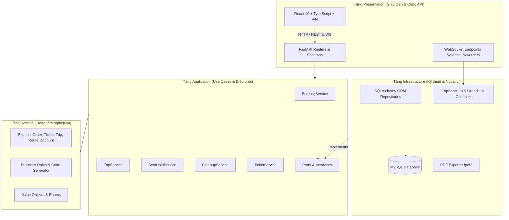
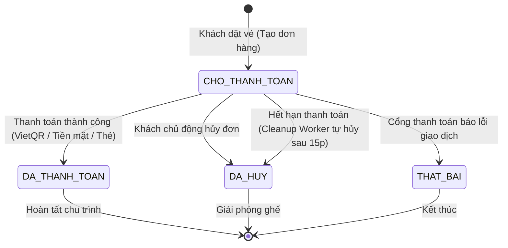
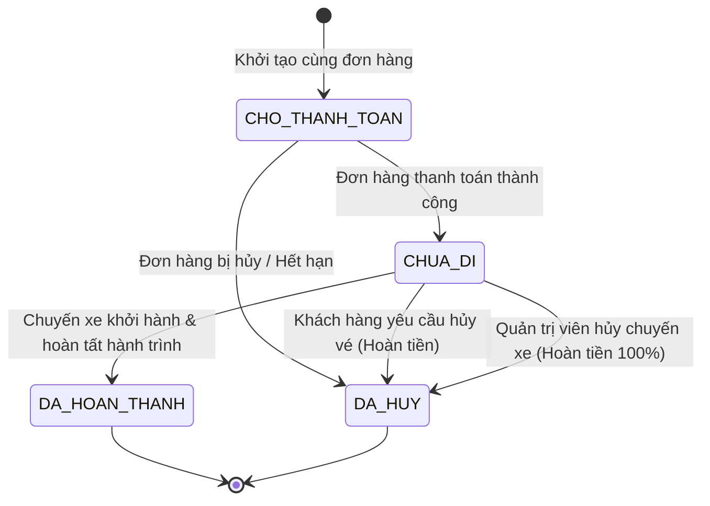
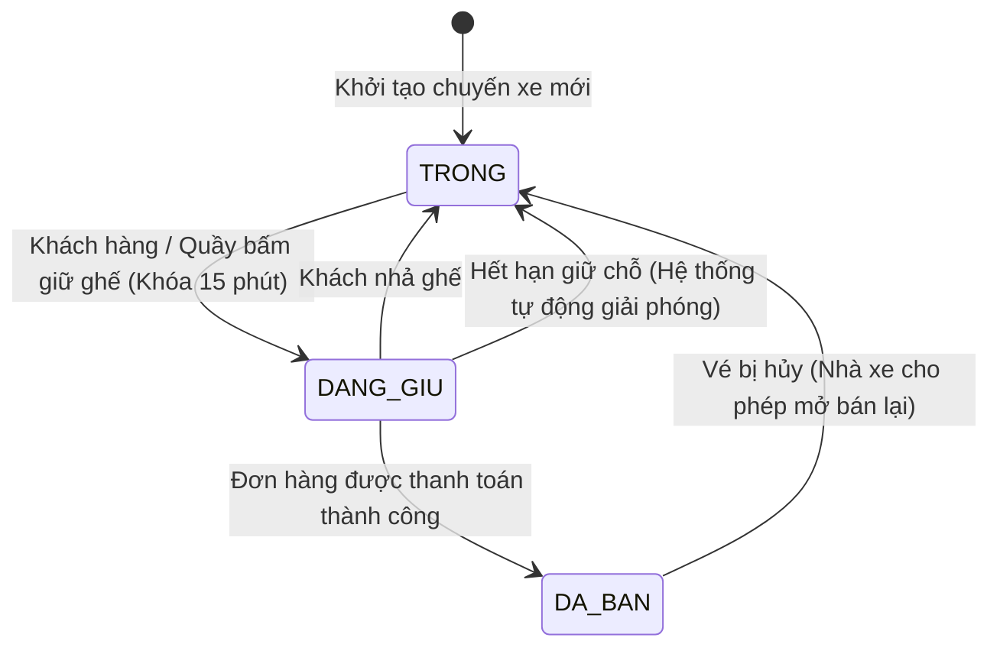

# BÁO CÁO THIẾT KẾ & ÁNH XẠ KIẾN TRÚC OOAD VÀO HỆ THỐNG
**Đồ án Môn học:** Phân tích & Thiết kế Hướng đối tượng (OOAD) — HK1 2026-2027  
**Đề tài:** Hệ Thống Quản Trị & Đặt Vé Xe Khách Liên Tỉnh (OOAD Bus Ticket System)

---

## 1. TỔNG QUAN KIẾN TRÚC PHẦN MỀM (CLEAN ARCHITECTURE & DDD)

Hệ thống được thiết kế và triển khai tuân thủ nghiêm ngặt mô hình **Clean Architecture (Onion Architecture)** kết hợp với **Domain-Driven Design (DDD)** nhằm bảo đảm tính độc lập, dễ kiểm thử (testability) và tuân thủ các nguyên lý **SOLID**:

### Nguyên tắc phân tầng:
1. **Domain Layer (Trọng tâm)**: Chứa các thực thể (`Order`, `Ticket`, `Trip`, `Route`, `Account`), quy tắc tính phí hủy, quy tắc sinh mã định danh có quy tắc (`code_generator.py`). Không phụ thuộc vào bất kỳ framework hoặc cơ sở dữ liệu nào.
2. **Application Layer (Use Cases)**: Hiện thực hóa các ca sử dụng nghiệp vụ. Điều phối luồng dữ liệu giữa Domain và các cổng giao tiếp (Ports).
3. **Infrastructure Layer**: Hiện thực các Interface của Application Layer (SQLAlchemy ORM, MySQL DB, WebSocket Hubs, xuất file PDF/Excel).
4. **Presentation Layer**: FastAPI REST API, WebSocket routers và Giao diện React Frontend.

---

## 2. BẢNG ÁNH XẠ USE CASE (USE CASE TO CODE MAPPING)

| Mã UC | Tên Ca Sử Dụng (Use Case) | Tác Nhân (Actor) | Application Service | Domain Entity | API Endpoint | Giao diện Frontend |
| :--- | :--- | :--- | :--- | :--- | :--- | :--- |
| **UC01** | Đăng ký tài khoản (OTP) | Khách hàng | `AuthService.register` | `Account`, `Role` | `POST /auth/register` | `RegisterPage.tsx` |
| **UC02** | Đăng nhập hệ thống | Mọi tác nhân | `AuthService.login` | `Account` | `POST /auth/login` | `LoginPage.tsx`, `AdminLoginPage.tsx` |
| **UC03** | Tìm kiếm chuyến xe | Khách / Quầy | `TripService.search` | `Trip`, `Route` | `GET /trips/search` | `HomePage.tsx`, `ResultsPage.tsx` |
| **UC04** | Xem sơ đồ & Giữ chỗ tạm | Khách / Quầy | `SeatHoldService.hold` | `TripSeat`, `SeatState` | `POST /trips/{id}/hold` | `SeatsPage.tsx`, `CounterPage.tsx` |
| **UC05** | Nhả ghế giữ chỗ | Khách / Quầy | `SeatHoldService.release` | `TripSeat` | `POST /trips/{id}/release` | `SeatsPage.tsx` |
| **UC06** | Tạo đơn & Áp dụng coupon | Khách hàng | `BookingService.create_order` | `Order`, `Coupon` | `POST /orders` | `CheckoutPage.tsx` |
| **UC07** | Thanh toán đơn hàng | Khách / Quầy | `BookingService.pay` | `Order`, `Ticket`, `Payment`| `POST /orders/{id}/pay` | `CheckoutPage.tsx`, `CounterPage.tsx` |
| **UC08** | Xem chi tiết vé & In PDF | Khách hàng | `TicketService.get` | `TicketRecord` | `GET /tickets/{id}/pdf` | `SuccessPage.tsx`, `ProfilePage.tsx` |
| **UC09** | Báo giá & Hủy vé online | Khách hàng | `CancellationService.cancel`| `Refund`, `Ticket` | `POST /tickets/{id}/cancel` | `TicketLookupPage.tsx`, `ProfilePage.tsx` |
| **UC10** | Tra cứu vé công khai | Khách / Vãng lai | `TicketService.lookup` | `Ticket` | `GET /tickets/lookup` | `TicketLookupPage.tsx` |
| **UC11** | Bán vé tại quầy (POS) | Nhân viên quầy | `CounterService.create_order` | `CounterSale`, `Order` | `POST /counter/orders` | `CounterPage.tsx` |
| **UC12** | In phôi vé giấy POS | Nhân viên quầy | `CounterService.get_receipts`| `Ticket` | `GET /counter/orders/{id}/receipts`| `CounterPage.tsx` |
| **UC13** | Hủy vé tại quầy (tiền mặt)| Nhân viên quầy | `CounterService.cancel_ticket`| `Refund` | `POST /counter/tickets/{id}/cancel`| `CounterPage.tsx` |
| **UC14** | Soát vé lên xe (QR Code) | Nhân viên soát vé| `TicketService.lookup` | `Ticket` | `GET /tickets/lookup` | `ScannerPage.tsx` |
| **UC15** | Báo cáo doanh thu thời gian thực | Quản trị viên | `ReportService.build` | `Report` | `GET /admin/reports` | `AdminDashboardPage.tsx` |
| **UC16** | Xuất báo cáo CSV/XLSX/PDF| Quản trị viên | `ReportService` / Exporters | `Report` | `GET /admin/reports/export.pdf`| `AdminDashboardPage.tsx` |
| **UC17** | Duyệt & Xử lý lại hoàn tiền | Quản trị viên | `RefundService.retry` | `Refund` | `POST /admin/refunds/{id}/retry` | `AdminTicketsPage.tsx` |
| **UC18** | Quản lý Chuyến xe & Hủy chuyến | Quản trị viên | `TripService.cancel_trip` | `Trip` | `POST /admin/trips/{id}/cancel` | `AdminTripsPage.tsx` |
| **UC19** | Điều chỉnh giá vé chuyến | Quản trị viên | `TripService.update_price` | `Trip` | `PATCH /admin/trips/{id}/price`| `AdminPricingPage.tsx` |
| **UC20** | Quản lý Đội xe & Sơ đồ ghế| Quản trị viên | `FleetService` | `Vehicle`, `Seat` | `POST /admin/vehicles` | `AdminBusesPage.tsx` |
| **UC21** | Quản lý Tuyến xe đường chạy | Quản trị viên | `TripService.create_route` | `Route` | `POST /admin/routes` | `AdminRoutesPage.tsx` |
| **UC22** | Khóa / Mở khóa tài khoản | Quản trị viên | `UserService.lock/unlock` | `Account` | `POST /admin/users/{id}/lock` | `AdminAccountsPage.tsx` |
| **UC23** | Cấu hình tham số hệ thống | Quản trị viên | `SettingsService.update` | `Setting` | `PATCH /admin/settings/{key}` | `AdminSettingsPage.tsx` |
| **UC24** | Thu hồi ghế & Hủy đơn quá hạn | Tự động / Admin | `CleanupService.cleanup` | `TripSeat`, `Order` | `POST /admin/settings/cleanup-expired`| `AdminSettingsPage.tsx` |

---

## 3. SƠ ĐỒ MÁY TRẠNG THÁI (STATE MACHINE DIAGRAMS)

### 3.1 Vòng đời Đơn hàng (`Order State Machine`)

### 3.2 Vòng đời Vé xe (`Ticket State Machine`)

### 3.3 Vòng đời Trạng thái Ghế chuyến (`Trip Seat State Machine`)

---

## 4. CÁC MẪU THIẾT KẾ ÁP DỤNG TRONG ĐỒ ÁN (DESIGN PATTERNS)

1. **Observer Pattern / Publish-Subscribe (Thời gian thực)**:
   - `TripSeatHub`: Quản lý danh sách các trình duyệt đang mở sơ đồ ghế của `trip_id`. Khi Use Case giữ/nhả/bán ghế chạy xong, Hub bắn broadcast sự kiện `SEATS_HELD`, `SEATS_RELEASED`, `SEATS_BOOKED` xuống WebSocket của toàn bộ client.
   - `OrderHub`: Quản lý kết nối theo dõi đơn hàng `order_id`. Khi có giao dịch thành công (VietQR webhook), Hub gửi sự kiện `ORDER_PAID` để trình duyệt tự động nhảy sang trang vé.
2. **Repository Pattern**:
   - Tách biệt hoàn toàn tầng lưu trữ dữ liệu (SQLAlchemy Models, MySQL) khỏi tầng nghiệp vụ (Entities). Các Use Case chỉ giao tiếp qua Interfaces (`TripRepository`, `BookingRepository`, `AccountRepository`).
3. **Factory / Code Generator Pattern**:
   - `code_generator.py`: Module hóa việc sinh mã nghiệp vụ theo quy chuẩn công nghiệp vận tải (`TX-HNDN`, `CX-HNDN-261112-1800`, `ORD-261112-0001`, `VE-261112-0001`, `HT-261112-0001`).
4. **Strategy Pattern**:
   - Các phương thức thanh toán (`VIETQR`, `MOMO`, `ZALOPAY`, `THE`, `TIEN_MAT`) được cấu trúc linh hoạt, xử lý qua các nhánh chiến lược độc lập.
