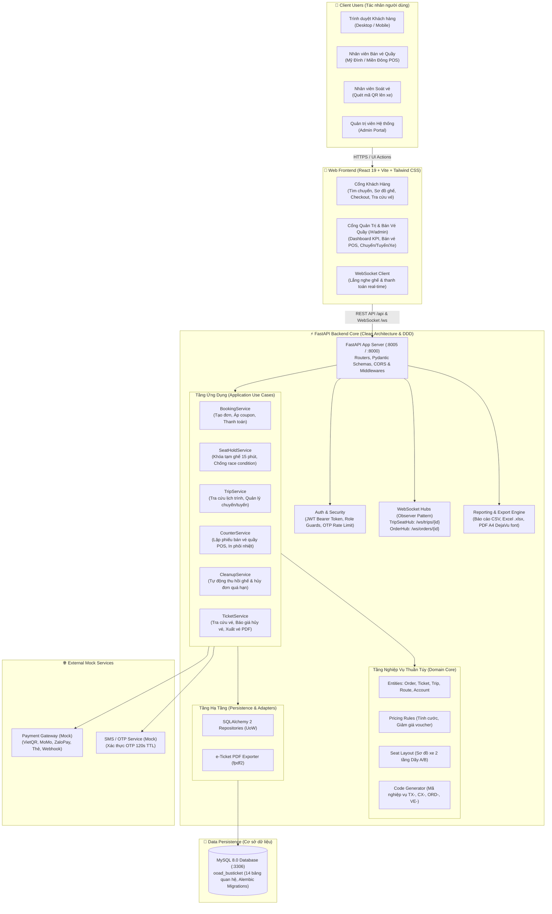

# HỆ THỐNG QUẢN LÝ & ĐẶT VÉ XE KHÁCH LIÊN TỈNH (OOAD BUS LINES)

> **Môn học:** Phân tích & Thiết kế Hướng đối tượng (OOAD) — HK1 2026-2027  
> **Đề tài:** Hệ thống Quản trị & Đặt vé xe khách trực tuyến  
> **Mô hình kiến trúc:** Clean Architecture + Domain-Driven Design (DDD)  
> **Công nghệ:** Python (FastAPI, SQLAlchemy 2) + React 19 (TypeScript, Vite, Tailwind CSS) + MySQL 8.0  
> **Trạng thái:** ✅ 100% Hoàn thành, 113/113 Tests Pass, E2E 44/44 Pass

---

## 🏛️ SƠ ĐỒ KIẾN TRÚC TỔNG THỂ (SYSTEM ARCHITECTURE)

Sơ đồ dưới đây được kết xuất từ đặc tả kiến trúc chuẩn tại thư mục [`.archify/architecture-bus-ticket-20261111/candidate.json`](file:///.archify/architecture-bus-ticket-20261111/candidate.json).  
Bạn có thể mở trực tiếp tệp tương tác trực quan tại [**`architecture.html`**](file:///home/long/Documents/University/HOCTAP/HK7/Object-Oriented Analysis and Design (OOAD)/DoAn/Project_OOAD_HK1_2026-2027/architecture.html).



---

## 🚀 HƯỚNG DẪN KHỞI CHẠY NHANH (QUICK START)

### Cách 1: Khởi chạy 1 lệnh duy nhất bằng Docker Compose (Khuyên dùng)
Hệ thống đã được đóng gói toàn diện cả Frontend, Backend và MySQL trong file [`docker-compose.yml`](file:///home/long/Documents/University/HOCTAP/HK7/Object-Oriented Analysis and Design (OOAD)/DoAn/Project_OOAD_HK1_2026-2027/docker-compose.yml):

```bash
docker compose up -d --build
```
* **Giao diện Web Khách hàng**: `http://localhost:5173`
* **Cổng Quản trị & Bán vé Quầy**: `http://localhost:5173/#/admin`
* **Swagger UI API Documentation**: `http://localhost:8005/docs` (hoặc `http://localhost:8000/docs`)

*(Container backend sẽ tự động đợi MySQL sẵn sàng, chạy migration Alembic và nạp 100% dữ liệu mẫu tự động).*

---

### Cách 2: Khởi chạy môi trường phát triển cục bộ (Local Dev)

#### 1. Khởi động Cơ sở dữ liệu MySQL:
```bash
docker compose up -d mysql
```

#### 2. Khởi động Backend (FastAPI):
```bash
cd backend
source .venv/bin/activate  # hoặc .venv\Scripts\activate trên Windows
alembic upgrade head       # Nâng cấp database schema
python -m uvicorn app.main:app --host 0.0.0.0 --port 8005 --reload
```

#### 3. Khởi động Frontend (React 19 + Vite):
```bash
cd frontend
npm install
npm run dev
```
Trình duyệt sẽ tự động mở tại `http://localhost:5173`.

---

## 🔑 DANH SÁCH TÀI KHOẢN THỬ NGHIỆM (SEEDED ACCOUNTS)

Cơ sở dữ liệu đã có sẵn các tài khoản demo đầy đủ dữ liệu thực tế:

| Số điện thoại | Mật khẩu | Quyền hạn (`Role`) | Họ tên & Vai trò | Giao diện sử dụng |
| :--- | :--- | :--- | :--- | :--- |
| `0900000000` | `Admin12345` | **ADMIN** | Quản trị viên hệ thống | `http://localhost:5173/#/admin` |
| `0900000001` | `Staff12345` | **NHAN_VIEN_BAN_VE** | Nhân viên quầy Mỹ Đình | `http://localhost:5173/#/admin` |
| `0900000003` | `Staff12345` | **NHAN_VIEN_BAN_VE** | Nhân viên quầy Miền Đông | `http://localhost:5173/#/admin` |
| `0900000002` | `Khach12345` | **KHACH_HANG** | Nguyễn Văn An (có lịch sử vé) | `http://localhost:5173` |
| `0900000010` | `Khach12345` | **KHACH_HANG** | Trần Thị Bình (vé VietQR) | `http://localhost:5173` |
| `0900000012` | `Khach12345` | **KHACH_HANG** | Phạm Minh Đức (vé lỗi hoàn tiền) | `http://localhost:5173` |

---

## 🏷️ QUY CHUẨN MÃ ĐỊNH DANH LAI (HYBRID IDENTIFIER ARCHITECTURE)

Hệ thống kết hợp tối ưu giữa **Khóa chính nhân tạo tự tăng (`id INT PK`)** để tối ưu hóa hiệu năng truy vấn CSDL và **Mã định danh nghiệp vụ có quy tắc (`code VARCHAR UNIQUE`)** phục vụ người dùng:

| Thực thể | Mã nghiệp vụ (`code`) | Quy chuẩn cấu trúc | Ví dụ minh họa |
| :--- | :--- | :--- | :--- |
| **Tuyến xe** | `TX-{ORIGIN}{DEST}` | Viết tắt 2 chữ cái thành phố đi - đến | `TX-HNDN`, `TX-SGDL` |
| **Chuyến xe** | `CX-{ROUTE}-{YYMMDD}-{HHMM}` | Tuyến + Ngày khởi hành + Giờ chạy | `CX-HNDN-261112-1800` |
| **Đơn đặt vé** | `ORD-{YYMMDD}-{id:04d}` | Tiền tố ORD + Ngày tạo + Số thứ tự 4 số | `ORD-261112-0001` |
| **Vé xe điện tử** | `VE-{YYMMDD}-{id:04d}` | Tiền tố VE + Ngày xuất + Số thứ tự 4 số | `VE-261112-0001` |
| **Lệnh hoàn tiền**| `HT-{YYMMDD}-{id:04d}` | Tiền tố HT + Ngày lệnh + Số thứ tự 4 số | `HT-261112-0001` |
| **Phương tiện** | Biển số xe Bộ GTVT | Biển kiểm soát phương tiện | `51B-123.45`, `29B-987.65` |
| **Ghế ngồi** | `A01`, `A02`, `B01` | Dãy tầng (A: Tầng 1, B: Tầng 2) + Thứ tự | `A01`, `B05` |

---

## 💡 CÁC TÍNH NĂNG ĐẶC BIỆT NÂNG TẦM ĐỒ ÁN OOAD

1. **Đồng bộ thời gian thực qua WebSocket (Observer Pattern)**:
   - `/ws/trips/{trip_id}`: Khi có người chọn giữ ghế, nhả ghế hoặc thanh toán, sơ đồ ghế trên toàn bộ các trình duyệt của khách hàng khác và nhân viên quầy tự động đổi màu tức thì mà không cần F5.
   - `/ws/orders/{order_id}`: Lắng nghe trạng thái thanh toán VietQR, tự động chuyển từ màn hình chờ sang màn hình vé thành công khi quét QR xong trên điện thoại.
2. **Cơ chế Chống Race Condition (Tranh chấp ghế đồng thời)**:
   - Áp dụng kỹ thuật nguyên tử *Atomic Compare-and-Swap* trong SQL (`UPDATE trip_seats WHERE status = 'TRONG'`).
   - Đã kiểm thử thực tế với script 10 luồng gửi đồng thời: Đúng 1 luồng thành công (200), 9 luồng còn lại nhận lỗi 409 Conflict.
3. **Background Cleanup Worker**:
   - Tự động giải phóng ghế giữ chỗ đã hết hạn 15 phút và tự động hủy các đơn hàng chưa thanh toán quá hạn sang `DA_HUY`.
4. **Xuất Vé Điện Tử PDF Chuẩn A4**:
   - Xuất vé điện tử PDF có dấu tiếng Việt tại `GET /tickets/{id}/pdf`, kèm mã QR và hướng dẫn lên xe trang trọng.

---

## 📊 KẾT QUẢ KIỂM THỬ TỰ ĐỘNG (AUTOMATED TEST VERIFICATION)

Hệ thống được bảo vệ bởi 5 bộ test tự động đạt tỷ lệ thành công 100%:

```
================================================================================
✅ Backend Unit & Integration Tests : 113 / 113 bài test PASS (100% trong 24.27s)
✅ Customer & Public API Verify     :  33 /  33 endpoints PASS (100%)
✅ End-to-End System Integration    :  44 /  44 test steps PASS (100% qua Vite proxy)
✅ Race Condition Concurrency Test  :  10 luồng -> 1 PASS (200), 9 CONFLICT (409)
✅ Frontend Production Build        :   0 errors, 0 warnings (Vite build in 271ms)
================================================================================
```

---

## 📑 LIÊN KẾT TÀI LIỆU QUAN TRỌNG

* [**`architecture.html`**](file:///home/long/Documents/University/HOCTAP/HK7/Object-Oriented Analysis and Design (OOAD)/DoAn/Project_OOAD_HK1_2026-2027/architecture.html): Sơ đồ kiến trúc phần mềm tương tác trực quan (kết xuất từ `.archify`).
* [**`OOAD_DESIGN_MAPPING.md`**](file:///home/long/Documents/University/HOCTAP/HK7/Object-Oriented Analysis and Design (OOAD)/DoAn/Project_OOAD_HK1_2026-2027/OOAD_DESIGN_MAPPING.md): Báo cáo đặc tả kiến trúc, ánh xạ 24 Use Cases vào Code và Sơ đồ máy trạng thái (State Machine).
* [**`API_TESTING_GUIDE.md`**](file:///home/long/Documents/University/HOCTAP/HK7/Object-Oriented Analysis and Design (OOAD)/DoAn/Project_OOAD_HK1_2026-2027/API_TESTING_GUIDE.md): Cẩm nang hướng dẫn kiểm thử thủ công qua Swagger UI và Postman.
* [**`Vexe_API_Collection.postman_collection.json`**](file:///home/long/Documents/University/HOCTAP/HK7/Object-Oriented Analysis and Design (OOAD)/DoAn/Project_OOAD_HK1_2026-2027/Vexe_API_Collection.postman_collection.json): Bộ sưu tập Postman v2.1 với đầy đủ pre-request scripts và biến môi trường.
