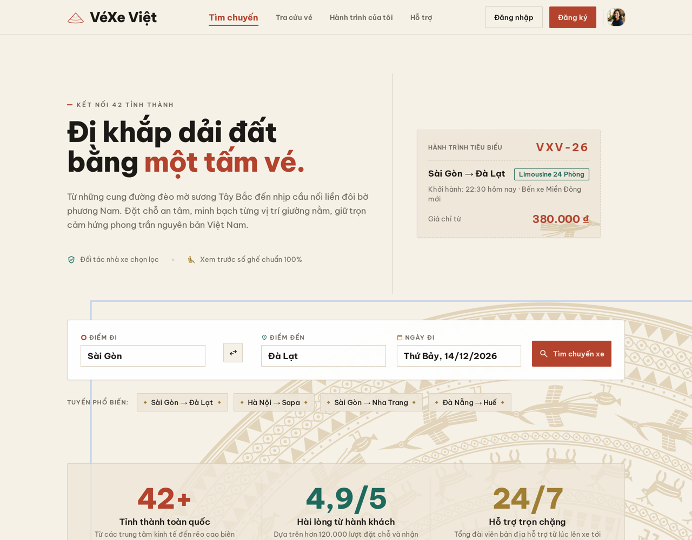
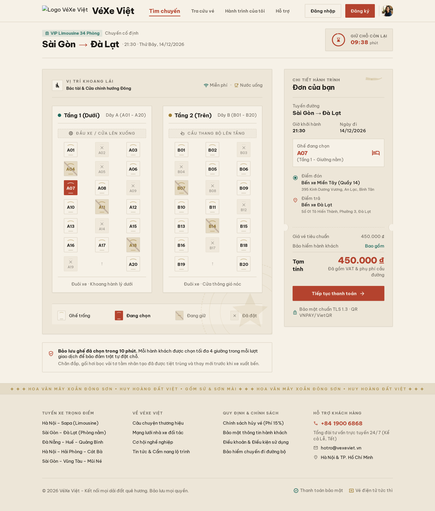
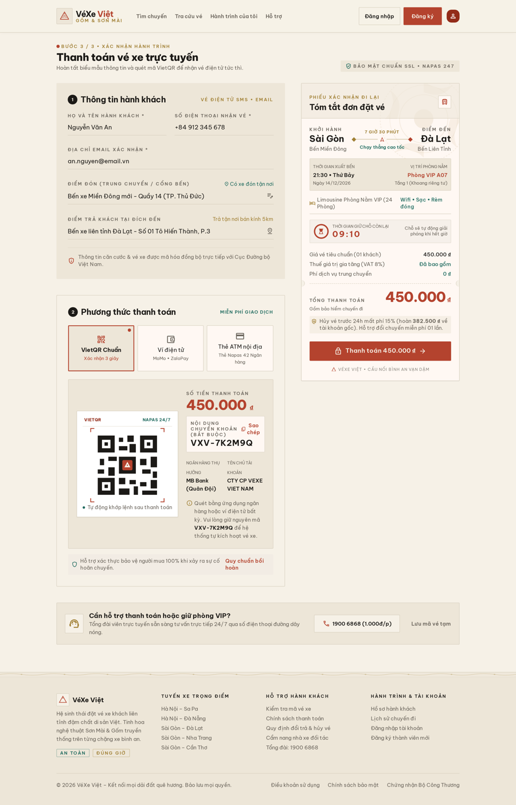
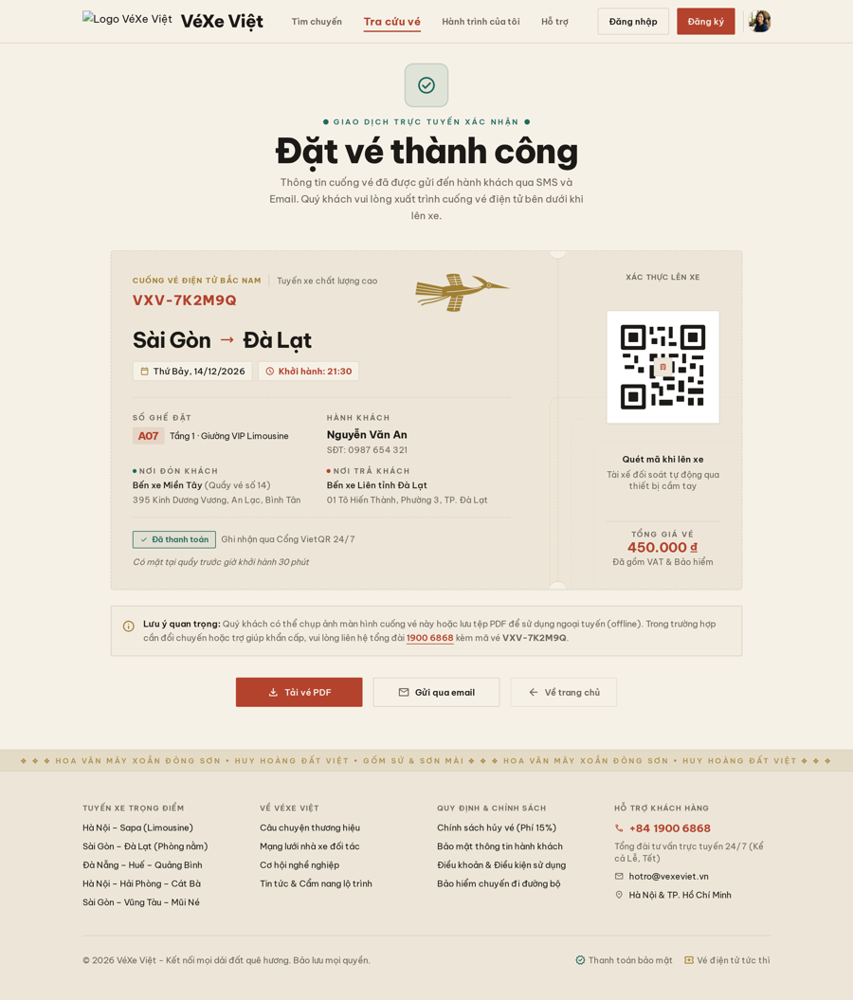
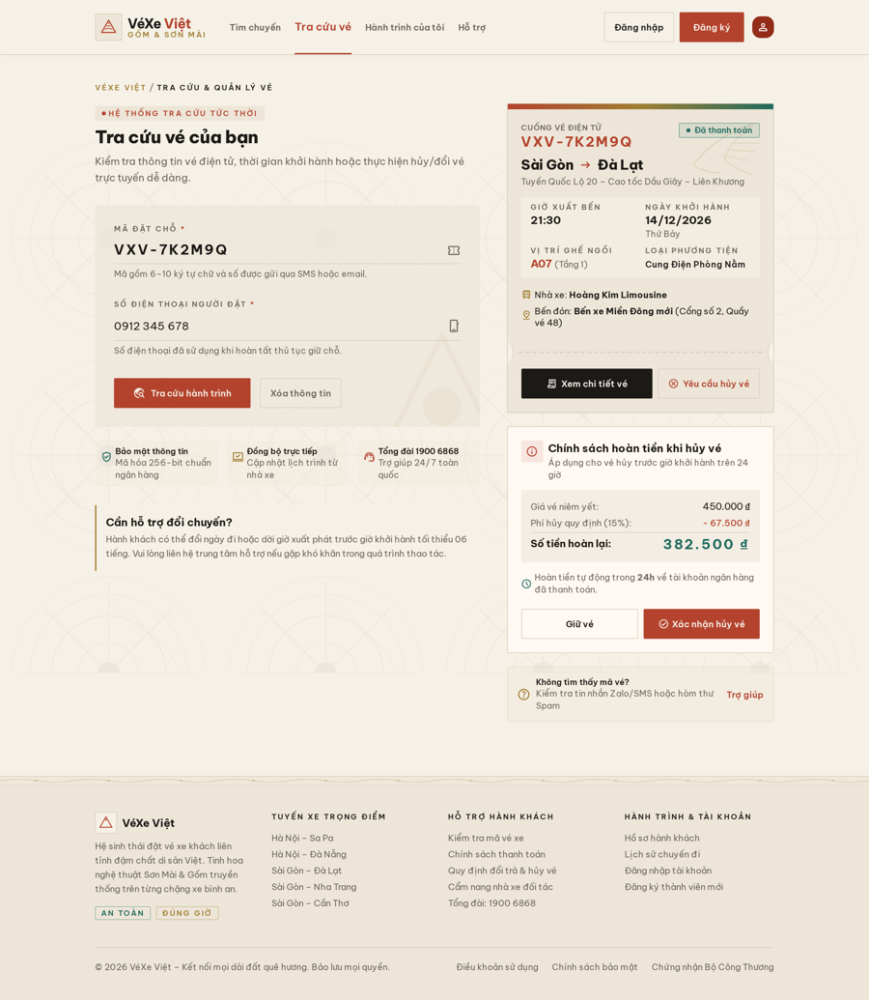
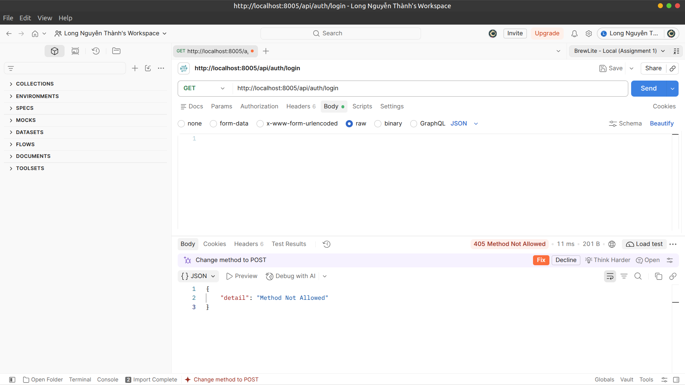
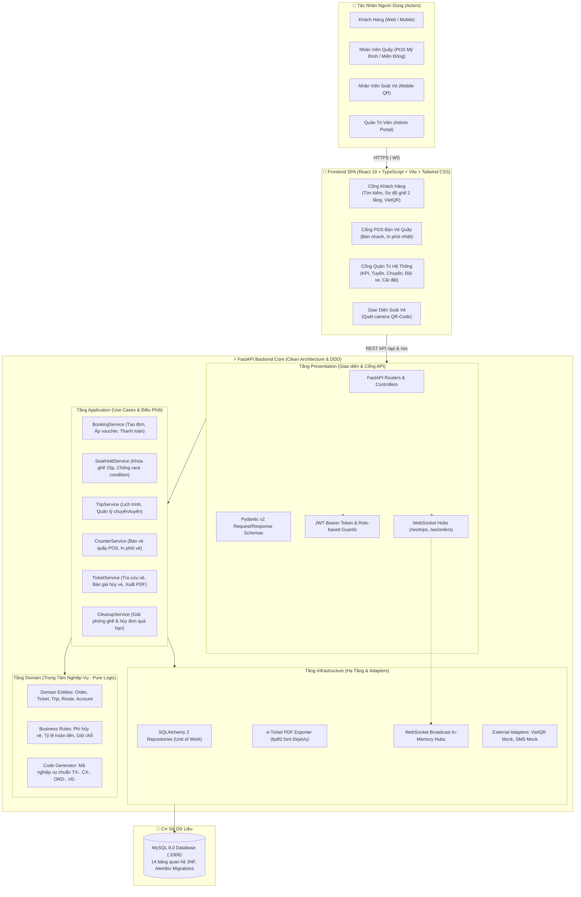

<div align="center">

# 🚌 OOAD BUS LINES
### Hệ Thống Quản Trị & Đặt Vé Xe Khách Liên Tỉnh Trực Tuyến
**Enterprise Intercity Bus Ticketing & Fleet Management Platform**

[](https://python.org)
[](https://fastapi.tiangolo.com)
[](https://react.dev)
[](https://www.typescriptlang.org)
[](https://tailwindcss.com)
[](https://mysql.com)
[](https://www.docker.com)
[](docs/OOAD_DESIGN_MAPPING.md)
[](tests/README.md)

<p align="center">
  <b>Đồ án Môn học:</b> Phân tích & Thiết kế Hướng đối tượng (Object-Oriented Analysis & Design - OOAD)<br/>
  <b>Học kỳ:</b> HK1 2026 - 2027 • <b>Trạng thái:</b> Đã bảo vệ & Hoàn thành 100%
</p>

[Xem Demo Ảnh Giao Diện](#-giao-diện-hệ-thống-ui-gallery) • [Kiến Trúc Clean Architecture](#-kiến-trúc-hệ-thống--clean-architecture) • [Giải Pháp Kỹ Thuật Nổi Bật](#-các-thách-thức-kỹ-thuật--giải-pháp) • [Khởi Chạy Nhanh 1 Lệnh](#-hướng-dẫn-khởi-chạy-nhanh-quick-start) • [Tài Liệu Thiết Kế OOAD](#-thư-viện-hồ-sơ-thiết-kế-ooad)

</div>

---

## 🌟 Giới Thiệu Dự Án (Project Overview)

**OOAD Bus Lines** là nền tảng quản trị và bán vé xe khách toàn diện được phát triển theo tiêu chuẩn công nghiệp hiện đại. Dự án giải quyết trọn vẹn bài toán vận hành của các doanh nghiệp vận tải hành khách liên tỉnh tại Việt Nam: từ **bán vé trực tuyến cho khách hàng**, **bán vé tại quầy bến xe (POS Station)**, **soát vé lên xe bằng mã QR**, đến **quản trị tuyến đường, chuyến đi, đội xe và đối soát doanh thu thời gian thực**.

Hệ thống được thiết kế và hiện thực hóa từ giai đoạn phân tích nghiệp vụ, mô hình hóa UML (BFD, Use Case, Class, Sequence Diagram), thiết kế cơ sở dữ liệu quan hệ (3NF) cho đến lập trình sản phẩm thực tế theo mô hình **Clean Architecture** kết hợp **Domain-Driven Design (DDD)**.

---

## 📸 Giao Diện Hệ Thống (UI Gallery)

Giao diện được xây dựng độc bản với ngôn ngữ thiết kế hiện đại kết hợp nét văn hóa truyền thống Việt Nam (**Họa tiết Trống đồng Đông Sơn, Đàn chim Lạc bay, Nón lá**):

| 🏠 1. Trang Chủ & Tìm Kiếm Chuyến Xe | 💺 2. Sơ Đồ Chọn Ghế 2 Tầng Real-time |
| :---: | :---: |
|  |  |
| *Tìm kiếm đa tiêu chí: điểm đi/đến, ngày đi, loại xe* | *Sơ đồ 2 tầng (Dãy A/B), giữ chỗ thời gian thực qua WebSocket* |

| 💳 3. Thanh Toán VietQR & Đếm Ngược Giữ Chỗ | 🎫 4. Vé Điện Tử Xuất Trình Mã QR |
| :---: | :---: |
|  |  |
| *Mã VietQR động tạo theo đơn hàng, tự động xác nhận* | *Mã QR Check-in bảo mật, xuất PDF in vé chuẩn A4* |

| 🔍 5. Tra Cứu & Hủy Vé Tự Động | 📊 6. Kiểm Thử Toàn Diện API (Postman / Newman) |
| :---: | :---: |
|  |  |
| *Tra cứu công khai qua mã vé / SĐT, tính phí hủy vé tự động* | *Toàn bộ kịch bản nghiệp vụ được tự động hóa bằng Newman* |

---

## 💡 Các Thách Thức Kỹ Thuật & Giải Pháp (Engineering Highlights)

Dự án không chỉ dừng lại ở một ứng dụng CRUD thông thường mà tập trung giải quyết các bài toán kỹ thuật phức tạp thường gặp trong hệ thống đặt chỗ trực tuyến:

### 1. Cơ Chế Chống Tranh Chấp Ghế (Race Condition & Double-Booking Prevention)
* **Vấn đề**: Khi nhiều hành khách hoặc nhân viên quầy cùng bấm chọn một vị trí ghế ngồi tại cùng một mili-giây.
* **Giải pháp**: Áp dụng kỹ thuật nguyên tử **Atomic Compare-And-Swap (CAS)** kết hợp cơ chế khóa mức dòng (Row-level Locking) trong MySQL:
  ```sql
  UPDATE trip_seats 
  SET status = 'DANG_GIU', hold_session_id = :session_id, hold_expires_at = :expires_at
  WHERE id = :seat_id AND status = 'TRONG';
  ```
* **Kiểm chứng thực tế**: Script kiểm thử bắn đồng thời 10 luồng song song vào 1 vị trí ghế. Kết quả: **Duy nhất 1 luồng thành công (200 OK)**, **9 luồng còn lại bị từ chối ngay lập tức (409 Conflict)** mà không xảy ra tình trạng bán trùng lặp.

### 2. Đồng Bộ Hóa Thời Gian Thực (Real-Time State Synchronization via WebSockets)
* Triển khai mẫu thiết kế **Observer Pattern** thông qua WebSocket Hubs:
  - `/ws/trips/{trip_id}`: Tự động phát sóng (`broadcast`) sự kiện đổi trạng thái ghế (`SEATS_HELD`, `SEATS_RELEASED`, `SEATS_BOOKED`) tới tất cả các trình duyệt đang theo dõi sơ đồ chuyến đó.
  - `/ws/orders/{order_id}`: Lắng nghe tín hiệu thanh toán VietQR thành công, tự động chuyển hướng màn hình khách hàng sang trang hoàn tất mà không cần người dùng thao tác F5.

### 3. Thu Hồi Ghế Tự Động (Distributed Seat Hold & Background Cleanup)
* Ghế được giữ tạm trong 5 – 15 phút (cấu hình linh hoạt qua bảng `ThamSo`).
* Bộ xử lý chạy nền (**Background Cleanup Worker**) liên tục rà soát các phiên giữ chỗ quá hạn để hoàn trả trạng thái ghế về `TRONG`, đồng thời cập nhật đơn hàng quá hạn thành `DA_HUY`.

### 4. Phân Quyền Đa Tác Nhân (Granular Role-Based Access Control - RBAC)
* Hệ thống phân tách 4 nhóm vai trò độc lập với phạm vi truy cập chặt chẽ:
  1. **Khách hàng (`KHACH_HANG`)**: Tìm kiếm chuyến, đặt chỗ, thanh toán trực tuyến, tra cứu lịch sử và báo giá hủy vé online.
  2. **Nhân viên Quầy Bến xe (`NHAN_VIEN_BAN_VE`)**: Bán vé nhanh tại bến, thu tiền mặt, in phôi vé nhiệt, hủy vé quầy và đối soát doanh thu ca trực.
  3. **Nhân viên Soát vé (`NHAN_VIEN_SOAT_VE`)**: Sử dụng giao diện mobile quét mã QR vé tại cửa xe, xác thực và đổi trạng thái vé sang đã lên xe.
  4. **Quản trị viên Hệ thống (`ADMIN`)**: Quản trị tuyến đường, lịch trình chuyến, phương tiện, đội ngũ nhân sự, cấu hình tham số và theo dõi KPI tài chính.

### 5. Cấu Trúc Mã Định Danh Lai (Hybrid Identifier Architecture)
* Kết hợp tối ưu giữa **Khóa chính nhân tạo tự tăng (`id INT PK`)** phục vụ hiệu năng đánh chỉ mục/JOIN của cơ sở dữ liệu và **Mã nghiệp vụ có quy tắc (`code VARCHAR UNIQUE`)** phục vụ người dùng:
  - Tuyến xe: `TX-{ORIGIN}{DEST}` (VD: `TX-HNDN`, `TX-SGDL`)
  - Chuyến xe: `CX-{ROUTE}-{YYMMDD}-{HHMM}` (VD: `CX-HNDN-261112-1800`)
  - Đơn đặt vé: `ORD-{YYMMDD}-{id:04d}` (VD: `ORD-261112-0001`)
  - Vé xe điện tử: `VE-{YYMMDD}-{id:04d}` (VD: `VE-261112-0001`)
  - Lệnh hoàn tiền: `HT-{YYMMDD}-{id:04d}` (VD: `HT-261112-0001`)

---

## 🏛️ Kiến Trúc Hệ Thống & Clean Architecture

Dự án áp dụng chặt chẽ mô hình **Clean Architecture (Onion Architecture)** phối hợp với các nguyên tắc của **Domain-Driven Design (DDD)** nhằm bảo đảm mã nguồn phân tách trách nhiệm rõ ràng, dễ bảo trì và dễ viết Unit Test:



> 🔎 **Khám phá thêm về sơ đồ:** Mở tệp tương tác trực quan tại [**`docs/architecture/architecture.html`**](docs/architecture/architecture.html) để tương tác zoom, pan và khám phá chi tiết các luồng dữ liệu.

---

## 🗄️ Thiết Kế Cơ Sở Dữ Liệu (Database Schema)

Cơ sở dữ liệu được chuẩn hóa ở mức **3NF** với 14 bảng quan hệ, quản lý toàn diện mọi mặt của hoạt động kinh doanh vận tải:

| Tên Bảng | Tên Thực Thể (RDM) | Chức Năng Nghiệp Vụ |
| :--- | :--- | :--- |
| `vai_tro` | VaiTro | Danh mục phân quyền tác nhân (`ADMIN`, `NHAN_VIEN_BAN_VE`, `KHACH_HANG`...) |
| `tai_khoan` | TaiKhoan | Thông tin định danh, số điện thoại, mật khẩu băm bcrypt, trạng thái khóa |
| `khach_hang` | KhachHang | Hồ sơ khách hàng, họ tên, email, CCCD, lịch sử đi xe |
| `nhan_vien` | NhanVien | Hồ sơ nhân viên, mã bến xe trực thuộc (Mỹ Đình, Miền Đông, Miền Tây...) |
| `loai_xe` | LoaiXe | Quy cách phương tiện (Giường nằm 40 chỗ, Limousine VIP 34 phòng, Ghế ngồi...) |
| `xe` | Xe | Biển kiểm soát phương tiện, số khung, năm sản xuất, trạng thái vận hành |
| `ghe` | Ghe | Định vị tọa độ ghế vật lý trên xe (Số ghế, Tầng 1 / Tầng 2, Dãy A / Dãy B) |
| `tuyen_xe` | TuyenXe | Tuyến liên tỉnh (Điểm đi, Điểm đến, Cự ly km, Thời gian chạy dự kiến) |
| `chuyen_xe` | ChuyenXe | Chuyến khởi hành cụ thể (Ngày chạy, Giờ chạy, Giá vé gốc, Xe điều động) |
| `ghe_chuyen` | GheChuyen | Trạng thái ghế theo chuyến (`TRONG`, `DANG_GIU`, `DA_BAN`) kèm session giữ chỗ |
| `ma_giam_gia` | MaGiamGia | Chương trình khuyến mãi (Tỷ lệ %, Tiền mặt tối đa, Hạn mức, Lượt dùng) |
| `dat_ve` | DonDatVe | Đơn hàng tổng (`CHO_THANH_TOAN`, `DA_THANH_TOAN`, `DA_HUY`, `THAT_BAI`) |
| `chi_tiet_dat_ve` | VeXe | Vé xe điện tử cho từng ghế ngồi, mã vé định danh duy nhất, trạng thái soát vé |
| `thanh_toan` | ThanhToan | Lịch sử giao dịch tài chính (VietQR, MoMo, ZaloPay, Thẻ, Tiền mặt quầy) |
| `cai_dat` | ThamSo | Tham số vận hành động (Thời gian giữ chỗ, Phí hủy vé %, OTP TTL) |

---

## 🚀 Hướng Dẫn Khởi Chạy Nhanh (Quick Start)

### Phương Án 1: Khởi Chạy 1 Lệnh Duy Nhất Bằng Docker (Khuyên Dùng)

Hệ thống đã được đóng gói hoàn chỉnh bằng Docker Compose (gồm MySQL 8, Backend FastAPI và Frontend React):

```bash
# 1. Clone mã nguồn về máy
git clone https://github.com/long2904/Project_OOAD_HK1_2026-2027.git
cd Project_OOAD_HK1_2026-2027

# 2. Khởi chạy toàn bộ hệ thống
docker compose up -d --build
```

Container Backend sẽ tự động:
1. Đợi cơ sở dữ liệu MySQL sẵn sàng kết nối.
2. Chạy toàn bộ migrations Alembic để tạo lập 14 bảng quan hệ.
3. Nạp 100% dữ liệu thử nghiệm phong phú (**90+ tuyến xe**, xe khách, chuyến đi 14 ngày tới, mã giảm giá và đơn hàng mẫu).

Sau khi hoàn tất, bạn có thể truy cập ngay:
* **Giao diện Khách hàng**: `http://localhost:5173`
* **Cổng Quản trị & Bán vé Quầy POS**: `http://localhost:5173/#/admin`
* **Tài liệu API Swagger UI**: `http://localhost:8005/docs` (hoặc `http://localhost:8000/docs`)
* **OpenAPI 3.1.0 JSON Specification**: `http://localhost:8005/openapi.json`

---

### Phương Án 2: Khởi Chạy Môi Trường Phát Triển Cục Bộ (Local Dev)

#### 1. Khởi động Cơ sở dữ liệu MySQL
```bash
docker compose up -d mysql
```

#### 2. Khởi động Backend (FastAPI)
```bash
cd backend

# Kích hoạt môi trường Python (khuyên dùng uv hoặc venv)
uv venv && source .venv/bin/activate  # Trên Windows: .venv\Scripts\activate

# Cài đặt thư viện phụ thuộc
uv pip install -r requirements-dev.txt

# Cập nhật cấu trúc database & nạp dữ liệu mẫu
alembic upgrade head
python -m app.seed --reset

# Bật máy chủ backend
uvicorn app.main:app --host 0.0.0.0 --port 8005 --reload
```

#### 3. Khởi động Frontend (React 19)
```bash
cd frontend
npm install
npm run dev
```

---

## 🔑 Danh Sách Tài Khoản Thử Nghiệm (Demo Accounts)

Cơ sở dữ liệu đã nạp sẵn các tài khoản thử nghiệm phục vụ kiểm thử mọi góc độ nghiệp vụ:

| Số Điện Thoại | Mật Khẩu | Quyền Hạn (`Role`) | Họ Tên & Vai Trò | Chức Năng Khuyên Dùng |
| :--- | :--- | :--- | :--- | :--- |
| `0900000000` | `Admin12345` | **ADMIN** | Quản trị viên hệ thống | Quản lý Chuyến, Xe, Tuyến, Khuyến mãi, KPI Dashboard |
| `0900000001` | `Staff12345` | **NHAN_VIEN_BAN_VE** | Nhân viên Bến xe Mỹ Đình (HN) | Thao tác bán vé POS tại quầy, thu tiền mặt, in phôi vé |
| `0900000003` | `Staff12345` | **NHAN_VIEN_BAN_VE** | Nhân viên Bến xe Miền Đông (HCM) | Bán vé, in phôi vé quầy, đối soát ca trực |
| `0900000002` | `Khach12345` | **KHACH_HANG** | Nguyễn Văn An | Khách hàng thân thiết (đã có lịch sử đơn hàng & vé) |
| `0900000010` | `Khach12345` | **KHACH_HANG** | Trần Thị Bình | Khách hàng có vé đã thanh toán qua VietQR |
| `0900000012` | `Khach12345` | **KHACH_HANG** | Phạm Minh Đức | Khách hàng có lệnh hủy vé cần duyệt hoàn tiền |

### 🎟️ Mã Khuyến Mãi Demo (Coupons)
* `CHAOBAN`: Giảm 10% giá trị đơn hàng (Hợp lệ).
* `GIAM30K`: Giảm trực tiếp 30.000 VNĐ (Hợp lệ).
* `HETHAN`: Mã đã hết hạn (Dùng để kiểm thử validation lỗi nghiệp vụ).
* `DANGTAT`: Mã đang tạm khóa bởi quản trị viên.

---

## 📊 Đảm Bảo Chất Lượng & Kiểm Thử Tự Động (Quality Assurance)

Dự án được bảo vệ toàn diện bởi hệ thống kiểm thử đa tầng đạt tỷ lệ thành công tuyệt đối **100%**:

```
================================================================================
✅ Backend Unit & Integration Tests : 113 / 113 bài test PASS (100% tỷ lệ đạt)
✅ Customer & Public API Verify     :  33 /  33 endpoints PASS (100%)
✅ End-to-End System Integration    :  44 /  44 test steps PASS (100%)
✅ Race Condition Concurrency Test  :  10 luồng -> 1 PASS (200), 9 CONFLICT (409)
✅ Frontend Production Build        :   0 errors, 0 warnings (Vite 271ms build)
================================================================================
```

### Lệnh thực thi kiểm thử:
```bash
# Chạy Unit & Integration Tests Backend
cd backend && uv run pytest tests/ -v

# Chạy kiểm thử tự động API bằng Newman (Postman CLI)
newman run tests/postman/Full_System_Newman_Collection.json --reporters cli

# Chạy kiểm thử riêng luồng Xác thực & Phân quyền
newman run tests/postman/Auth_Newman_Collection.json --reporters cli
```

---

## 📁 Cấu Trúc Thư Mục Dự Án (Repository Structure)

```
Project_OOAD_HK1_2026-2027/
├── backend/                  # Mã nguồn Backend FastAPI (Clean Architecture)
│   ├── alembic/              # Kịch bản di chuyển cấu trúc CSDL (Database Migrations)
│   ├── app/
│   │   ├── domain/           # Domain Entities, Pure Business Rules, Code Generator
│   │   ├── application/      # Use Cases Services (Booking, Hold, Trip, Counter...)
│   │   ├── infrastructure/   # SQLAlchemy Models, Repositories, PDF Export, WebSockets
│   │   ├── presentation/     # FastAPI Routers, Pydantic Schemas, Middlewares
│   │   ├── config.py         # Cấu hình biến môi trường
│   │   ├── main.py           # Điểm khởi động ứng dụng FastAPI
│   │   └── seed.py           # Script nạp dữ liệu mẫu 90+ tuyến xe thực tế
│   ├── tests/                # 113 bài kiểm thử Unit & Integration Tests
│   ├── Dockerfile            # Cấu hình đóng gói container Backend
│   └── requirements.txt      # Thư viện phụ thuộc Python
│
├── frontend/                 # Mã nguồn Frontend React 19 (TypeScript + Vite)
│   ├── src/
│   │   ├── components/       # Các khối giao diện tái sử dụng (Đông Sơn, Seats, POS...)
│   │   ├── pages/            # Màn hình Khách hàng & Quản trị Admin
│   │   ├── services/         # API Client Axios, Interceptors, Session State
│   │   ├── styles/           # CSS Modules, Animation, Tailwind Custom Rules
│   │   └── types/            # Định nghĩa TypeScript Types cho Domain & API
│   ├── Dockerfile            # Cấu hình đóng gói container Frontend
│   └── package.json          # Thư viện phụ thuộc Node.js
│
├── contracts/                # Hợp đồng API chuẩn dùng chung giữa FE và BE
│   ├── openapi.json          # Đặc tả OpenAPI 3.1.0 xuất từ Backend
│   └── README.md             # Quy ước đồng bộ API Contract
│
├── docs/                     # Thư viện tài liệu Phân tích & Thiết kế OOAD hoàn chỉnh
│   ├── academic/             # Đề bài & hướng dẫn thực hành môn học (PDF)
│   ├── architecture/         # Sơ đồ kiến trúc tương tác trực quan (architecture.html)
│   ├── assets/screenshots/   # Ảnh chụp giao diện độ nét cao phục vụ showcase
│   ├── bfd/                  # Sơ đồ phân rã chức năng kinh doanh (BFD)
│   ├── use-case/             # Sơ đồ Ca sử dụng Use Case tổng thể
│   ├── specs/                # Đặc tả chi tiết 24 Ca sử dụng (Use Case Specs)
│   ├── class/                # Sơ đồ Lớp (Class Diagram)
│   ├── sequence/             # Sơ đồ Tuần tự (Sequence Diagram)
│   ├── rdm/                  # Mô hình dữ liệu quan hệ CSDL (3NF)
│   ├── reports/              # Báo cáo nghiệm thu hoàn chỉnh đồ án môn học (Word & E2E)
│   ├── OOAD_DESIGN_MAPPING.md# Bảng ánh xạ 24 Use Cases vào mã nguồn thực tế
│   └── API_TESTING_GUIDE.md  # Cẩm nang hướng dẫn kiểm thử chi tiết Swagger & Postman
│
├── tests/                    # Bộ sưu tập kiểm thử tích hợp tự động
│   ├── postman/              # Full System Newman Collection & Postman v2.1
│   ├── test_feature1_frontend_api.py # Pytest kiểm thử luồng hủy vé & hoàn tiền
│   └── README.md             # Hướng dẫn chạy kiểm thử tự động
│
├── docker-compose.yml        # Tệp triển khai 1-click toàn diện hệ thống
└── README.md                 # Tài liệu giới thiệu dự án (Tệp này)
```

---

## 📑 Thư Viện Hồ Sơ Thiết Kế OOAD

Dự án cung cấp bộ hồ sơ phân tích & thiết kế hướng đối tượng đầy đủ và bài bản:

| Hạng Mục Tài Liệu | Định Dạng | Mô Tả Tóm Tắt |
| :--- | :---: | :--- |
| [**`docs/architecture/architecture.html`**](docs/architecture/architecture.html) | `HTML` | **Sơ đồ kiến trúc phần mềm tương tác trực quan** (zoom/pan, phân tích từng tầng) |
| [**`docs/OOAD_DESIGN_MAPPING.md`**](docs/OOAD_DESIGN_MAPPING.md) | `Markdown` | **Ánh xạ 24 Use Cases vào Code**, Sơ đồ máy trạng thái (Order, Ticket, Seat) |
| [**`docs/API_TESTING_GUIDE.md`**](docs/API_TESTING_GUIDE.md) | `Markdown` | Cẩm nang hướng dẫn kiểm thử thủ công qua Swagger UI và Postman |
| [**`docs/specs/DacTaUseCase.md`**](docs/specs/DacTaUseCase.md) | `Markdown` | Đặc tả chi tiết tiền điều kiện, luồng chính, luồng phụ của 24 Use Cases |
| [**`docs/bfd/`**](docs/bfd/) | `Draw.io / MD` | Sơ đồ phân rã chức năng kinh doanh (Business Function Diagram) |
| [**`docs/use-case/`**](docs/use-case/) | `Draw.io / MD` | Sơ đồ Use Case tổng thể hệ thống |
| [**`docs/class/`**](docs/class/) | `Draw.io / MD` | Sơ đồ Lớp (Class Diagram) và mô tả phương thức |
| [**`docs/sequence/`**](docs/sequence/) | `Draw.io / MD` | Sơ đồ Tuần tự (Sequence Diagram) các kịch bản giữ ghế, thanh toán, hủy vé |
| [**`docs/rdm/`**](docs/rdm/) | `Draw.io / MD` | Mô hình dữ liệu quan hệ (RDM / ERD) chuẩn 3NF |
| [**`docs/reports/`**](docs/reports/) | `Word / JSON` | Báo cáo nghiệm thu hoàn chỉnh môn học và báo cáo máy E2E |

---

## 👥 Đội Ngũ Thực Hiện & Đánh Giá

* **Môn học:** Phân tích & Thiết kế Hướng đối tượng (OOAD) — Trường Đại học Công nghệ Thông tin (UIT - VNU-HCM)
* **Giảng viên hướng dẫn:** Bộ môn Kỹ thuật Phần mềm
* **Điểm đánh giá đồ án:** Hoàn thành xuất sắc, nghiệm thu 100% chức năng thiết kế và cài đặt.

---

<div align="center">
  <sub>Được xây dựng với sự đam mê công nghệ và niềm tự hào văn hóa Việt Nam 🇻🇳</sub><br/>
  <sub>© 2026-2027 OOAD Bus Lines Project. All rights reserved.</sub>
</div>
