# PHÂN HỆ 05: SƠ ĐỒ TUẦN TỰ (SEQUENCE DIAGRAM)
*(Tương ứng Bài thực hành BTH 5)*

> **File này là nguồn sự thật của sơ đồ tuần tự.** Các khối ```mermaid``` dưới đây sinh ra
> `Sequence_DatVeXeKhach.drawio` (22 tab). Muốn sửa sơ đồ thì **sửa mermaid ở đây**, rồi chạy:
>
> ```bash
> python docs/sequence/gen_sequence_drawio.py
> ```
>
> **Không sửa trực tiếp trong draw.io** — lần sau chạy script là mất. Kiểm tra hai bên còn
> khớp: `python -m pytest docs/sequence/test_gen_sequence.py -q`.
>
> Đây là **ngoại lệ** của quy ước chung "drawio là nguồn, md mô tả lại": riêng sơ đồ tuần tự
> thì md là nguồn, vì trước đây sửa tay hai nơi đã làm 6/20 sơ đồ lệch khỏi tài liệu.
>
> Mọi giá trị trạng thái phải nằm trong danh sách enum ở `docs/rdm/RDM.md` mục 5.

---

## 🌳 MỤC LỤC TÓM TẮT CÁC SƠ ĐỒ TUẦN TỰ

```text
HỆ THỐNG ĐẶT VÉ XE KHÁCH (SEQUENCE DIAGRAMS)
│
├── 1. GIAI ĐOẠN 1: MỨC PHÂN TÍCH (LUỒNG TÁC NGHIỆP)
│   ├── 1.1. Khách hàng Đặt vé & Thanh toán trực tuyến
│   └── 1.2. Bán vé trực tiếp & Thanh toán tại quầy bến xe
│
├── 2. GIAI ĐOẠN 2: MỨC THIẾT KẾ CHI TIẾT (MÔ HÌNH 3 LỚP BCE)
│   ├── 2.1. Tạm khóa chỗ ngồi (UC02)
│   ├── 2.2. Xử lý Thanh toán & Xuất vé điện tử (UC22)
│   ├── 2.3. Bán vé & in vé tại quầy (UC04)
│   ├── 2.4. Đăng ký tài khoản (UC08)
│   ├── 2.5. Đăng nhập Hệ thống (UC09)
│   ├── 2.6. Tra cứu & Tìm chuyến xe (UC01)
│   ├── 2.7. Hủy vé trực tuyến (UC05)
│   ├── 2.8. Hủy vé tại quầy (UC06)
│   ├── 2.9. Khôi phục mật khẩu (UC10)
│   ├── 2.10. Lịch sử mua vé (UC07)
│   ├── 2.11. Quản lý thông tin cá nhân (UC11)
│   ├── 2.12. Đổi mật khẩu (UC12)
│   ├── 2.13. Quản lý chuyến xe & lịch trình (UC13)
│   ├── 2.14. Quản lý xe & sơ đồ ghế (UC14)
│   ├── 2.15. Quản lý giá vé (UC15a)
│   ├── 2.16. Quản lý khuyến mãi (UC15b)
│   ├── 2.17. Quản lý tài khoản & phân quyền (UC16)
│   ├── 2.18. Thống kê & báo cáo doanh thu (UC17)
│   ├── 2.19. Quản lý đơn đặt vé (UC18)
│   └── 2.20. Quản lý tham số hệ thống (UC19)
│
└── 3. BẢNG TỔNG KẾT ÁNH XẠ THÔNG ĐIỆP
```

---
## 1. GIAI ĐOẠN 1: BIỂU ĐỒ TUẦN TỰ BAN ĐẦU (MỨC PHÂN TÍCH / LUỒNG TÁC NGHIỆP)
*(Áp dụng đầy đủ ô chữ nhật đứng / activation bars cho các tác nhân và các thành phần hệ thống theo đúng luồng tác nghiệp thực tế)*

### 1.1. Luồng tác nghiệp 1: Khách hàng Đặt vé & Thanh toán trực tuyến (Kênh Website / Mobile)
*(Khách hàng thực hiện tra cứu, chọn ghế trên sơ đồ 2 tầng, thanh toán trực tuyến và nhận vé điện tử kèm mã QR)*

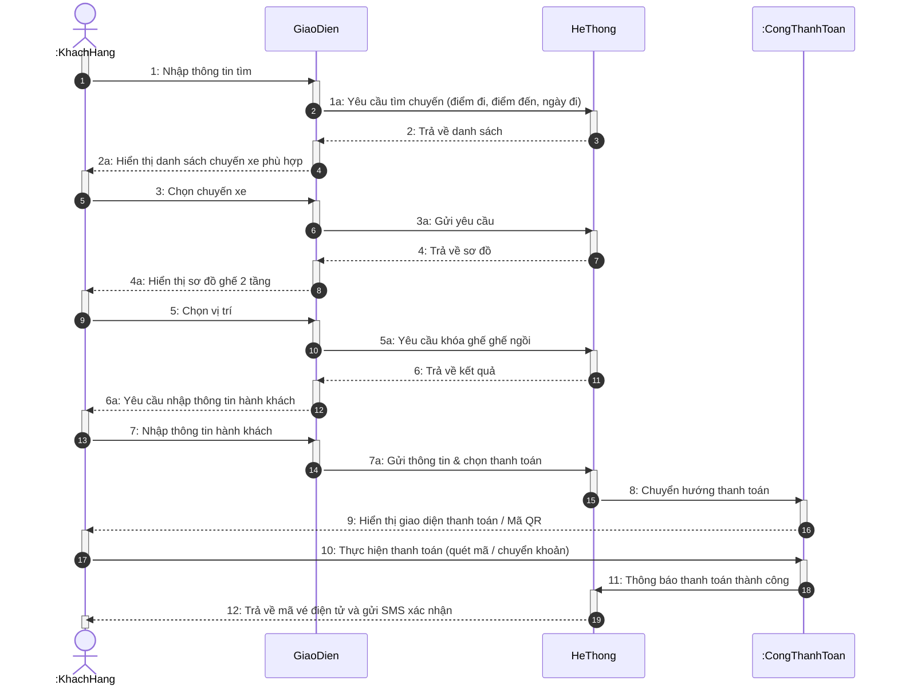

---

### 1.2. Luồng tác nghiệp 2: Bán vé trực tiếp & Thanh toán tại quầy bến xe (Kênh Quầy vé / Nhân viên)
*(Nhân viên bán vé tiếp nhận yêu cầu từ hành khách tại quầy bến xe, tra cứu chuyến, tư vấn vị trí ghế, xác nhận thu tiền mặt hoặc quét VietQR qua hệ thống thanh toán và bàn giao vé cho khách)*

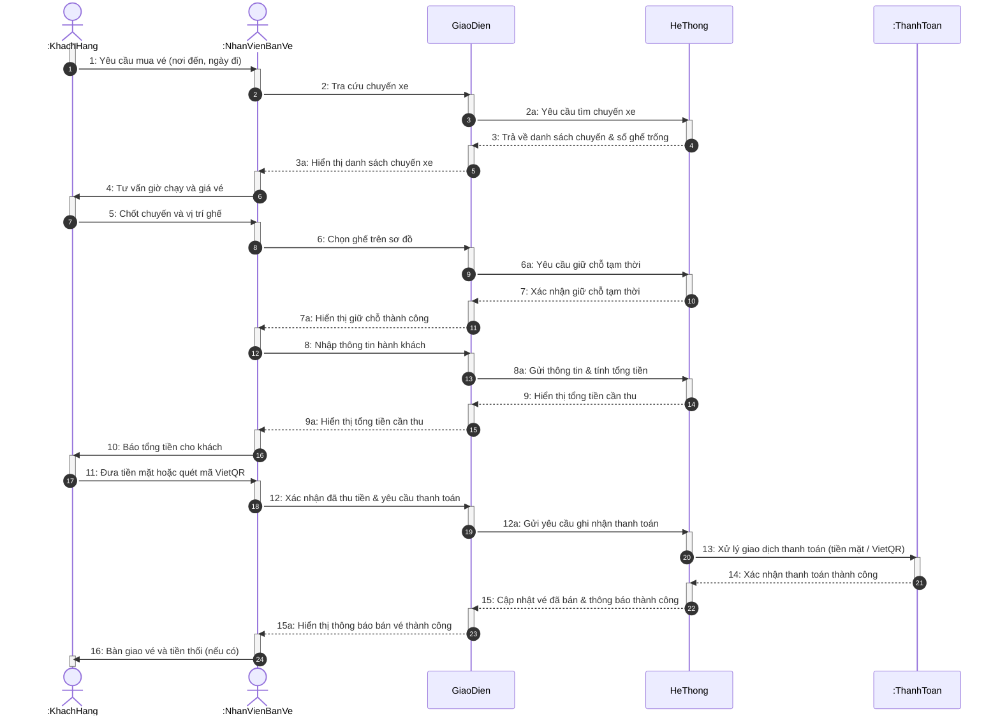

---

## 2. GIAI ĐOẠN 2: BIỂU ĐỒ TUẦN TỰ THIẾT KẾ CHI TIẾT (MÔ HÌNH 3 LỚP BCE)

---

### 2.1. Sơ đồ Tuần tự Chi tiết: Tạm khóa chỗ ngồi (UC02)
- **Ngữ cảnh:** Khách hàng chọn vị trí ghế ngồi trên sơ đồ xe, hệ thống kiểm tra và tạm khóa vị trí ghế trong phiên đặt vé (5 phút), xử lý tình huống ghế còn trống, ghế xung đột và giải phóng ghế khi hết thời gian.
- **Thành phần:**
  - `Boundary`: `:ManHinhChonGhe`
  - `Control`: `:DieuKhienGiuCho`
  - `Entity`: `:Ghe`

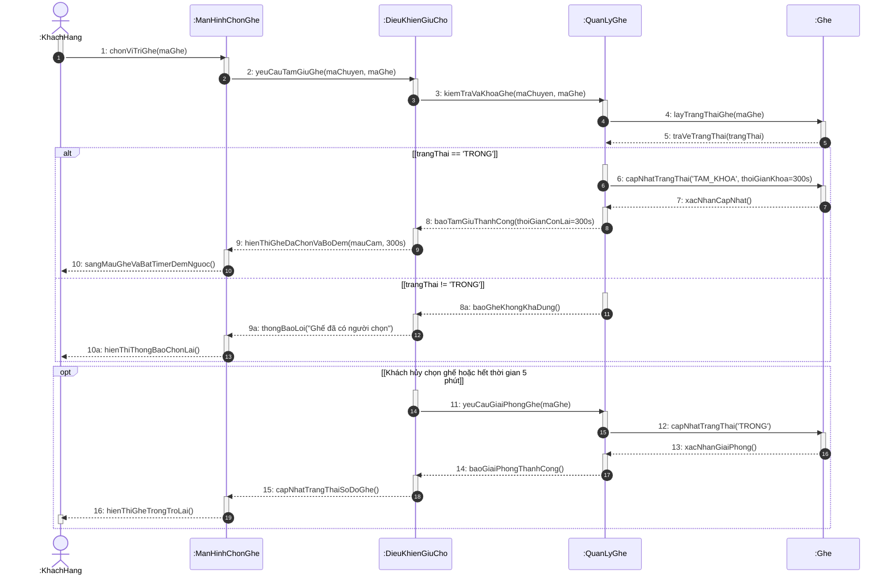

---

### 2.2. Sơ đồ Tuần tự Chi tiết: Xử lý Thanh toán & Xuất vé điện tử (UC22)
- **Ngữ cảnh:** Cổng thanh toán gửi thông báo webhook kết quả giao dịch, hệ thống đối soát, cập nhật vé chính thức và sinh mã QR. Webhook báo thành công nhưng về **muộn** (đơn đã hết hạn giữ chỗ) thì hệ thống tự lập lệnh hoàn 100% với lý do `THANH_TOAN_QUA_HAN`.
- **Thành phần:**
  - `Boundary / External`: `:CongThanhToan`
  - `Control`: `:DieuKhienThanhToan`, `:DichVuVe`, `:DichVuThongBao`
  - `Entity`: `:DonDatVe`, `:VeXe`, `:Ghe`, `:HoanTien`
  - `Actor`: `:KhachHang`

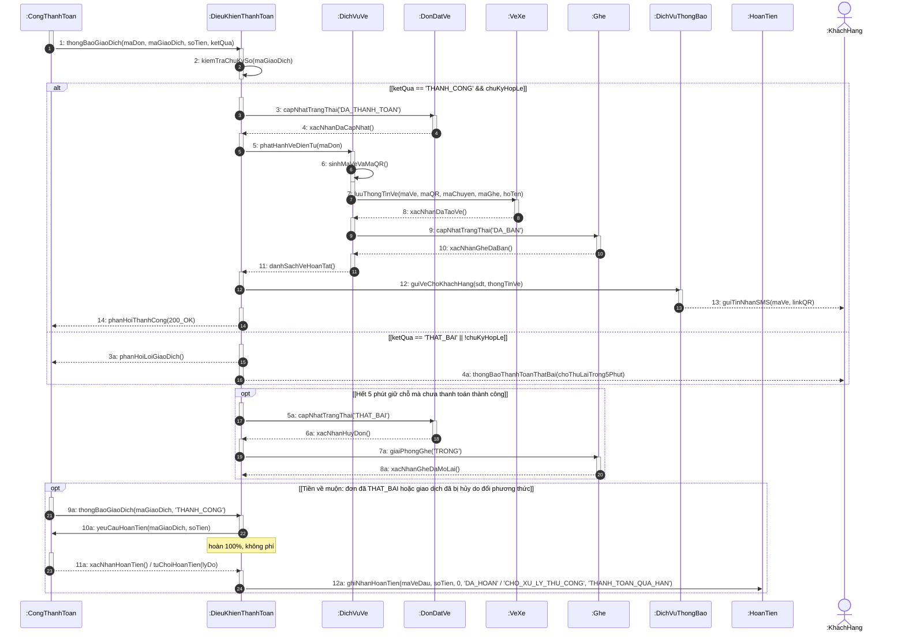

---

### 2.3. Sơ đồ Tuần tự Chi tiết: Bán vé & in vé tại quầy (UC04)
- **Ngữ cảnh:** Nhân viên quầy bán vé cho **khách vãng lai không cần tài khoản**: tra chuyến → chọn ghế và giữ chỗ → nhập họ tên / SĐT khách → thu tiền mặt hoặc VietQR → in vé giấy. Đơn có `KenhBan='TAI_QUAY'`, `DonDatVe.MaTK` để **NULL**, và đúng một bản ghi `BanVeQuay` ghi nhân viên bán kèm thời điểm. Họ tên và SĐT khách lưu ở `VeXe.HoTenHK` / `VeXe.SDTHK`.
- **Thành phần:**
  - `Actor`: `:NhanVienBanVe`, `:KhachHang`
  - `Boundary`: `:ManHinhBanVeQuay`
  - `Control`: `:DieuKhienBanVeQuay`, `:QuanLyGhe`
  - `Entity`: `:Ghe`, `:DonDatVe`, `:VeXe`, `:BanVeQuay`
  - `External / Device`: `:CongThanhToan`, `:MayInVe`

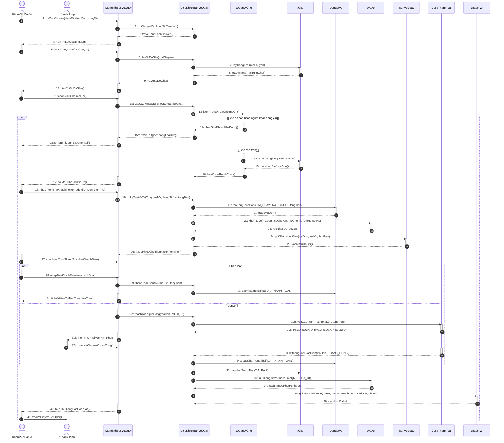

---

### 2.4. Sơ đồ Tuần tự Chi tiết: Đăng ký tài khoản (UC08)
- **Ngữ cảnh:** Người dùng chưa có tài khoản, thực hiện đăng ký bằng cách nhập thông tin và xác thực mã OTP gửi về số điện thoại qua dịch vụ SMS.
- **Thành phần:**
  - `Boundary`: `:ManHinhDangKy`
  - `Control`: `:DieuKhienDangKy`
  - `Entity`: `:TaiKhoan`
  - `External`: `:DichVuSMS`

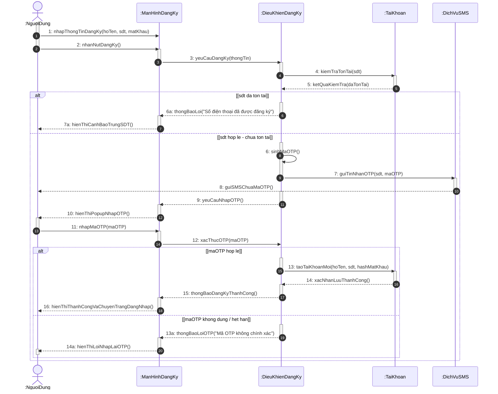

---

### 2.5. Sơ đồ Tuần tự Chi tiết: Đăng nhập Hệ thống (UC09)
- **Ngữ cảnh:** Người dùng đăng nhập vào hệ thống bằng thông tin đăng nhập, hệ thống kiểm tra mật khẩu, trạng thái khóa và khởi tạo phiên làm việc.
- **Thành phần:**
  - `Boundary`: `:ManHinhDangNhap`
  - `Control`: `:DieuKhienDangNhap`
  - `Entity`: `:TaiKhoan`

```mermaid
sequenceDiagram
    autonumber
    actor ND as :NguoiDung
    participant MH_DN as :ManHinhDangNhap
    participant DK_DN as :DieuKhienDangNhap
    participant TK as :TaiKhoan

    activate ND
    ND ->> MH_DN: 1: nhapThongTin(sdt, matKhau)
    ND ->> MH_DN: 2: nhanNutDangNhap()
    deactivate ND
    activate MH_DN
    MH_DN ->> DK_DN: 3: xuLyDangNhap(sdt, matKhau)
    deactivate MH_DN

    activate DK_DN
    DK_DN ->> TK: 4: timTaiKhoan(sdt)
    deactivate DK_DN
    activate TK
    TK -->> DK_DN: 5: traVeThongTin(taiKhoan, hashMatKhau, trangThai, vaiTro)
    deactivate TK

    alt [Khong tim thay hoac Sai mat khau]
        activate DK_DN
        DK_DN -->> MH_DN: 6a: thongBaoLoi("Số điện thoại hoặc mật khẩu không đúng")
        deactivate DK_DN
        activate MH_DN
        MH_DN -->> ND: 7a: hienThiLoiDangNhap()
        deactivate MH_DN
    else [Tai khoan bi khoa]
        activate DK_DN
        DK_DN -->> MH_DN: 6b: thongBaoLoi("Tài khoản đã bị khóa")
        deactivate DK_DN
        activate MH_DN
        MH_DN -->> ND: 7b: hienThiCanhBaoKhoaTaiKhoan()
        deactivate MH_DN
    else [Dang nhap thanh cong]
        activate DK_DN
        DK_DN ->> DK_DN: 6: taoPhienDangNhap(maTK, vaiTro)
        DK_DN -->> MH_DN: 7: traVeKetQua(thanhCong, vaiTro, token)
        deactivate DK_DN
        activate MH_DN
        MH_DN -->> ND: 8: hienThiTrangChinhTheoVaiTro(vaiTro)
        deactivate MH_DN
        activate ND
        deactivate ND
    end
```

---

### 2.6. Sơ đồ Tuần tự Chi tiết: Tra cứu & Tìm chuyến xe (UC01)
*(Áp dụng mô hình 3 lớp BCE để mô tả quá trình khách hàng nhập thông tin tìm chuyến xe)*

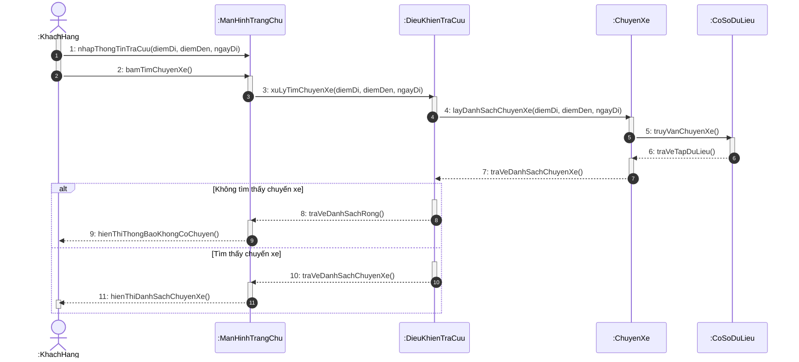

---

### 2.7. Sơ đồ Tuần tự Chi tiết: Hủy vé trực tuyến (UC05)
*(Áp dụng mô hình 3 lớp BCE để mô tả quá trình khách hàng hủy vé qua website/app và được hoàn tiền điện tử. Lệnh hoàn được ghi vào `:HoanTien`: cổng chấp nhận → `DA_HOAN`, cổng từ chối → `CHO_XU_LY_THU_CONG` và vé **vẫn hủy**, Admin xử lý tiếp ở UC18.)*

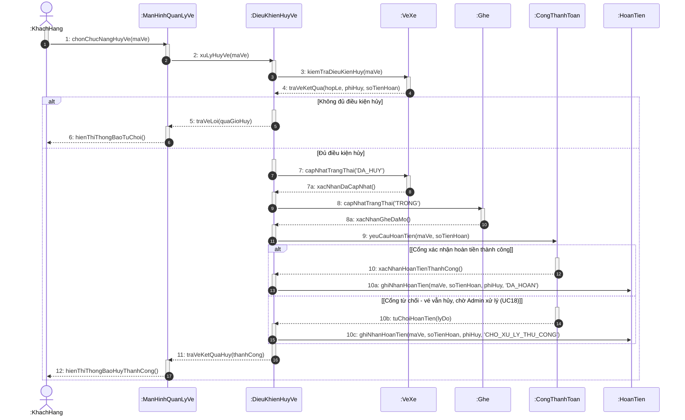

---

### 2.8. Sơ đồ Tuần tự Chi tiết: Hủy vé tại quầy (UC06)
*(Áp dụng mô hình 3 lớp BCE để mô tả nhân viên tra cứu vé, hủy vé, trả tiền và in biên nhận hủy cho khách. Vé trả bằng tiền mặt thì hoàn tiền mặt ngay tại quầy (`DA_HOAN`); vé trả qua cổng thì gọi `:CongThanhToan`, bị từ chối thì ghi `CHO_XU_LY_THU_CONG`.)*

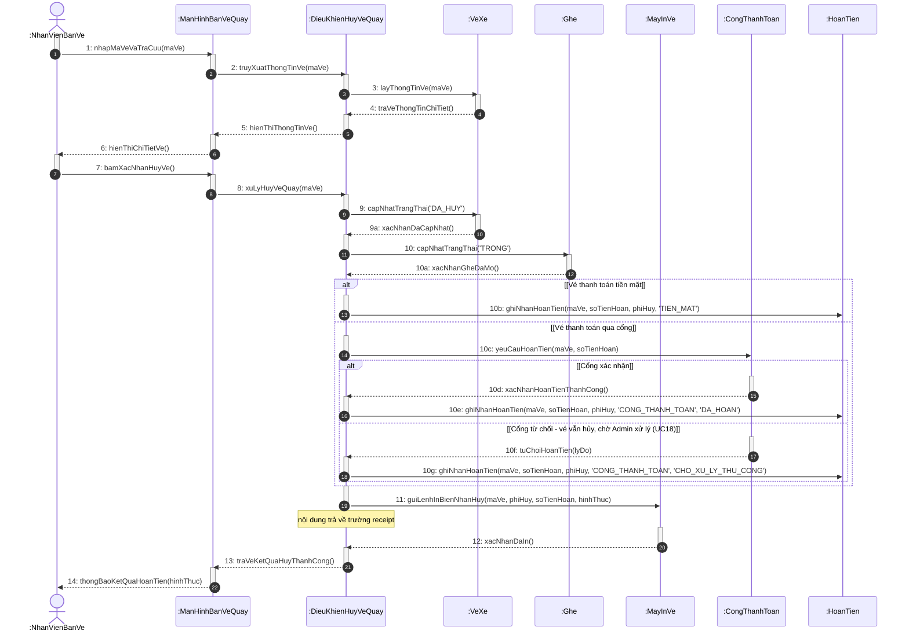

---

### 2.9. Sơ đồ Tuần tự Chi tiết: Khôi phục mật khẩu (UC10)
*(Áp dụng mô hình 3 lớp BCE để mô tả quá trình xác thực OTP qua SMS và cấp lại mật khẩu)*

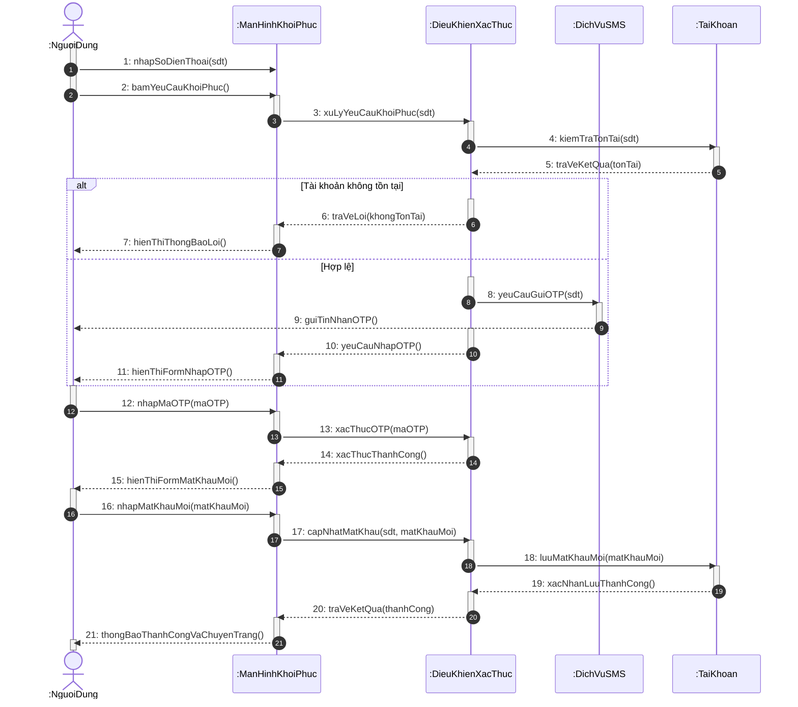

---

### 2.10. Sơ đồ Tuần tự Chi tiết: Lịch sử mua vé (UC07)
*(Khách hàng xem lịch sử vé; luồng mở rộng: lọc theo trạng thái vé)*

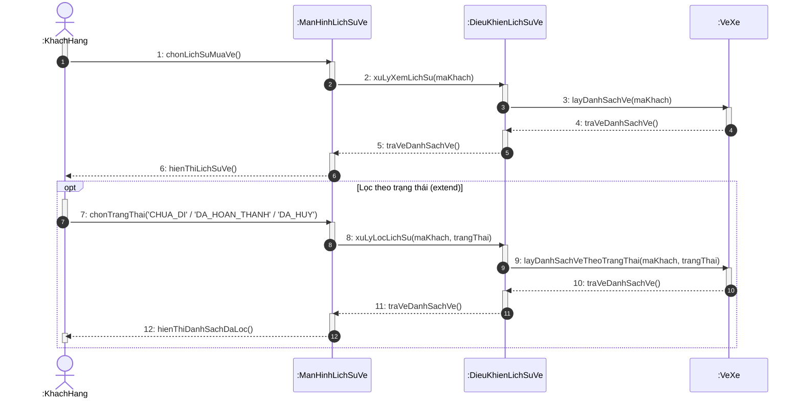

---

### 2.11. Sơ đồ Tuần tự Chi tiết: Quản lý thông tin cá nhân (UC11)
*(Khách hàng / Nhân viên bán vé / Admin xem hồ sơ của chính mình; hai luồng mở rộng: cập nhật thông tin, và **đổi số điện thoại** — gửi OTP tới số mới kèm nhập lại mật khẩu, thành công thì tăng `PhienBanToken` để thu hồi mọi phiên cũ và cấp token mới.)*

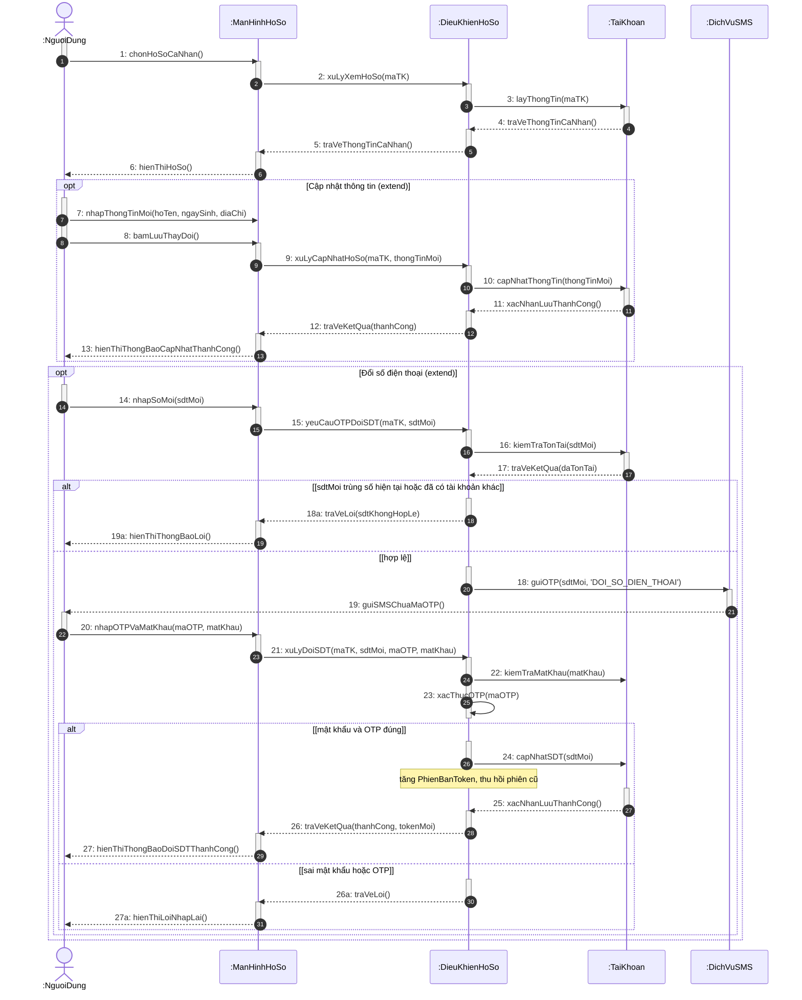

---

### 2.12. Sơ đồ Tuần tự Chi tiết: Đổi mật khẩu (UC12)

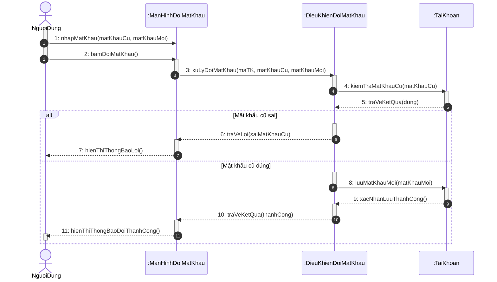

---

### 2.13. Sơ đồ Tuần tự Chi tiết: Quản lý chuyến xe & lịch trình (UC13)
*(Admin xem danh sách, thêm chuyến mới và hủy chuyến kèm hoàn tiền (include). Hủy chuyến thì hoàn **100%** mọi vé đã thanh toán (`PhiHuy=0`, lý do `NHA_XE_HUY_CHUYEN`), nhả ghế về `TRONG` và báo SMS cho khách. Các thao tác sửa/tìm kiếm tương tự luồng xem/thêm nên không vẽ lặp.)*

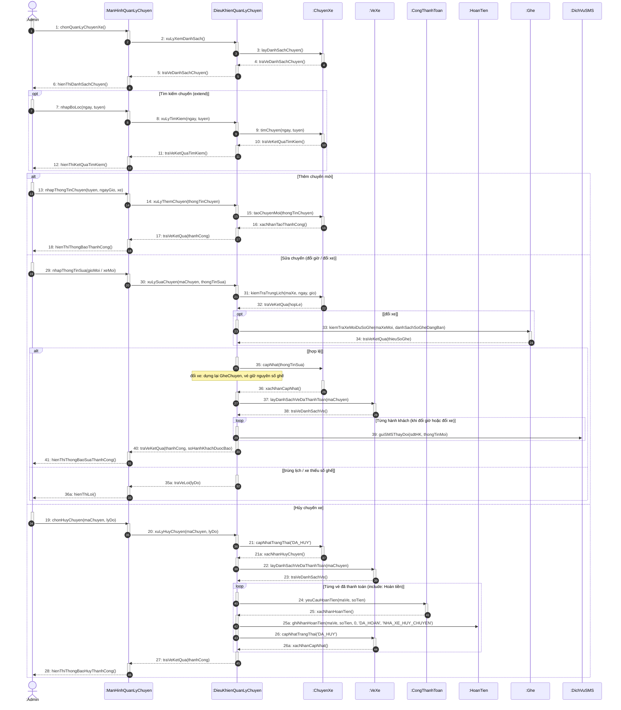

---

### 2.14. Sơ đồ Tuần tự Chi tiết: Quản lý xe & sơ đồ ghế (UC14)
*(Admin xem danh sách xe, thêm xe mới kèm thiết lập sơ đồ ghế (include) và ngừng hoạt động xe)*

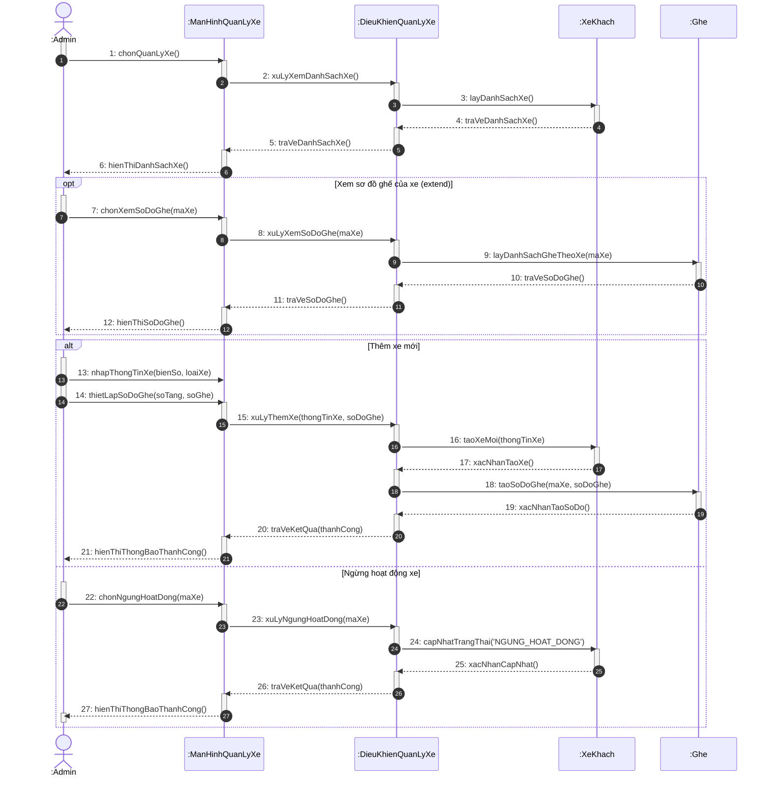

---

### 2.15. Sơ đồ Tuần tự Chi tiết: Quản lý giá vé (UC15a)
- **Ngữ cảnh:** Admin tra cứu danh sách bảng giá vé của các tuyến xe và cập nhật giá vé mới cho từng chuyến.
- **Thành phần:**
  - `Boundary`: `:ManHinhGiaVe`
  - `Control`: `:DieuKhienGiaVe`
  - `Entity`: `:ChuyenXe`

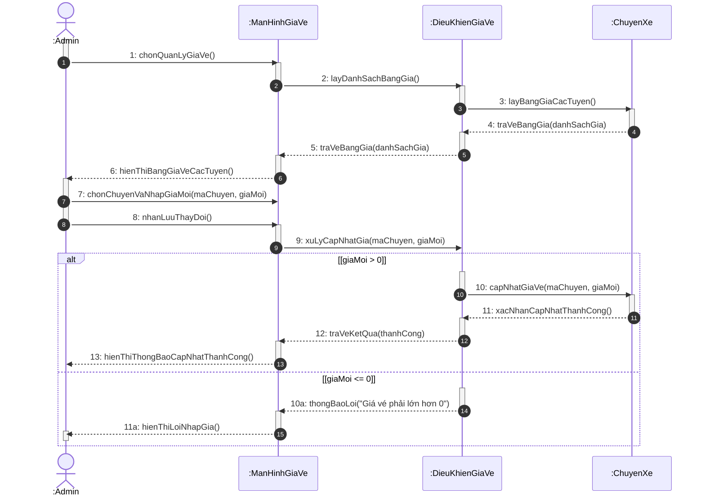

---

### 2.16. Sơ đồ Tuần tự Chi tiết: Quản lý khuyến mãi (UC15b)
- **Ngữ cảnh:** Admin xem danh sách mã giảm giá, thêm mã khuyến mãi mới hoặc bật/tắt (kích hoạt/hủy kích hoạt) mã giảm giá.
- **Thành phần:**
  - `Boundary`: `:ManHinhKhuyenMai`
  - `Control`: `:DieuKhienKhuyenMai`
  - `Entity`: `:MaGiamGia`

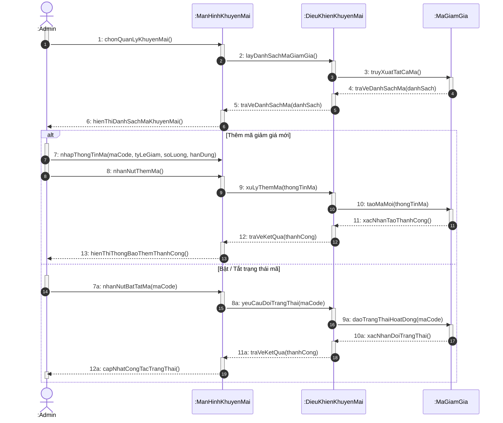

---

### 2.17. Sơ đồ Tuần tự Chi tiết: Quản lý tài khoản & phân quyền (UC16)
*(Admin xem danh sách, tạo tài khoản nhân viên kèm phân quyền (include) và khóa/mở khóa tài khoản)*

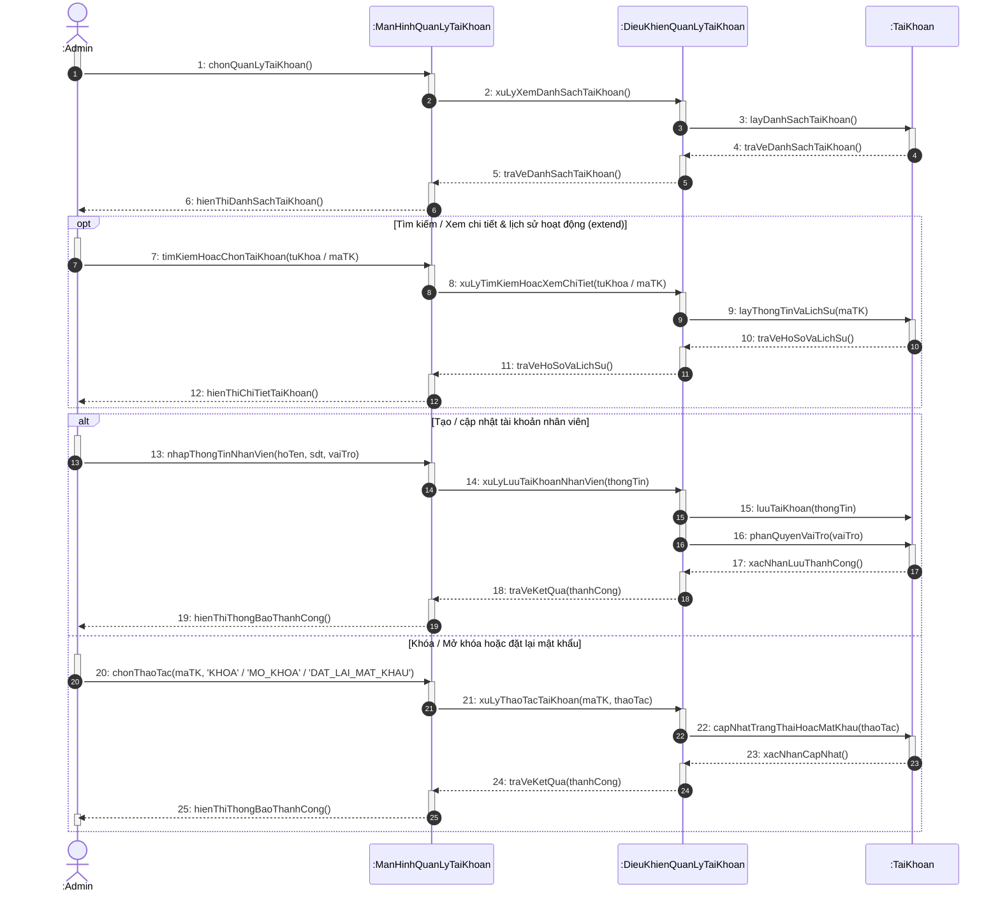

---

### 2.18. Sơ đồ Tuần tự Chi tiết: Thống kê & báo cáo doanh thu (UC17)
*(Admin xem Dashboard thống kê; luồng mở rộng: lọc theo thời gian và xuất báo cáo)*

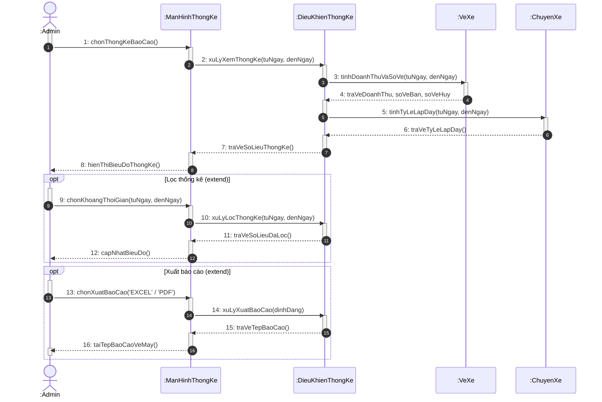

---

### 2.19. Sơ đồ Tuần tự Chi tiết: Quản lý đơn đặt vé (UC18)
- **Ngữ cảnh:** Admin tra cứu danh sách đơn đặt vé, tìm kiếm / lọc theo điều kiện, xem chi tiết vé và lịch sử hoàn tiền của đơn, rồi **xử lý lại một lệnh hoàn đang `CHO_XU_LY_THU_CONG`** (tab 17 của `UseCase_DatVeXeKhach.drawio`). Use case này **không hủy đơn, không hủy vé** — việc hủy đã xảy ra trước đó ở UC05 / UC06 / UC13; ở đây chỉ gọi lại cổng cho lệnh hoàn bị từ chối.
- **Thành phần:**
  - `Actor`: `:Admin`, `:CongThanhToan`
  - `Boundary`: `:ManHinhQuanLyDon`
  - `Control`: `:DieuKhienQuanLyDon`
  - `Entity`: `:DonDatVe`, `:VeXe`, `:HoanTien`

```mermaid
sequenceDiagram
    autonumber
    actor AD     as :Admin
    participant MH     as :ManHinhQuanLyDon
    participant DK     as :DieuKhienQuanLyDon
    participant DON    as :DonDatVe
    participant VE     as :VeXe
    participant HT     as :HoanTien
    participant CTT    as :CongThanhToan

    activate AD
    AD ->> MH: 1: chonQuanLyDonDatVe()
    deactivate AD
    activate MH
    MH ->> DK: 2: xuLyXemDanhSachDon()
    deactivate MH
    activate DK
    DK ->> DON: 3: layDanhSachDon()
    deactivate DK
    activate DON
    DON -->> DK: 4: traVeDanhSachDon()
    deactivate DON
    activate DK
    DK -->> MH: 5: traVeDanhSachDon()
    deactivate DK
    activate MH
    MH -->> AD: 6: hienThiDanhSachDon()
    deactivate MH
    opt Tìm kiếm / Lọc đơn (extend)
        activate AD
        AD ->> MH: 7: nhapBoLoc(trangThai, tuNgay, denNgay, kenh, soDienThoai, maDon)
        deactivate AD
        activate MH
        MH ->> DK: 8: xuLyLocDon(boLoc)
        deactivate MH
        activate DK
        DK ->> DON: 9: timDon(boLoc)
        deactivate DK
        activate DON
        DON -->> DK: 10: traVeKetQuaLoc()
        deactivate DON
        activate DK
        DK -->> MH: 11: traVeKetQuaLoc()
        deactivate DK
        activate MH
        MH -->> AD: 12: hienThiKetQuaLoc()
        deactivate MH
    end
    opt Xem chi tiết đơn (extend)
        activate AD
        AD ->> MH: 13: chonXemChiTietDon(maDon)
        deactivate AD
        activate MH
        MH ->> DK: 14: xuLyXemChiTietDon(maDon)
        deactivate MH
        activate DK
        DK ->> DON: 15: layChiTietDon(maDon)
        deactivate DK
        activate DON
        DON -->> DK: 16: traVeChiTietDon()
        deactivate DON
        activate DK
        DK ->> VE: 17: layDanhSachVeCuaDon(maDon)
        deactivate DK
        activate VE
        VE -->> DK: 18: traVeDanhSachVe()
        deactivate VE
        activate DK
        DK ->> HT: 19: layLichSuHoanTienCuaDon(maDon)
        deactivate DK
        activate HT
        HT -->> DK: 20: traVeLichSuHoanTien()
        deactivate HT
        activate DK
        DK -->> MH: 21: traVeChiTietDayDu()
        deactivate DK
        activate MH
        MH -->> AD: 22: hienThiChiTietDon()
        deactivate MH
    end
    activate AD
    AD ->> MH: 23: chonXuLyHoanTienThuCong(maHT)
    deactivate AD
    activate MH
    MH ->> DK: 24: xuLyHoanTienThuCong(maHT)
    deactivate MH
    activate DK
    DK ->> HT: 25: layLenhHoanChoXuLy(maHT)
    deactivate DK
    activate HT
    HT -->> DK: 26: traVeLenhHoan()
    deactivate HT
    activate DK
    DK ->> CTT: 27: yeuCauHoanTien(maVe, soTienHoan)
    deactivate DK
    alt [Cổng xác nhận hoàn thành công]
        activate CTT
        CTT -->> DK: 28: xacNhanHoanTienThanhCong()
        deactivate CTT
        activate DK
        DK ->> HT: 29: capNhatTrangThai('DA_HOAN')
        deactivate DK
        activate HT
        HT -->> DK: 30: xacNhanCapNhat()
        deactivate HT
        activate DK
        DK -->> MH: 31: traVeKetQua(thanhCong)
        deactivate DK
        activate MH
        MH -->> AD: 32: hienThiThongBaoHoanThanhCong()
        deactivate MH
    else [Cổng từ chối]
        activate CTT
        CTT -->> DK: 28a: tuChoiHoanTien(lyDo)
        deactivate CTT
        activate DK
        DK ->> HT: 29a: ghiLyDoLoi(lyDo)
        deactivate DK
        activate HT
        HT -->> DK: 30a: xacNhanDaGhi()
        deactivate HT
        activate DK
        DK -->> MH: 31a: traVeLoi(lyDo)
        deactivate DK
        activate MH
        MH -->> AD: 32a: hienThiLoiHoanTien()
        deactivate MH
    end
```

---

### 2.20. Sơ đồ Tuần tự Chi tiết: Quản lý tham số hệ thống (UC19)
- **Ngữ cảnh:** Admin xem và chỉnh **8 tham số vận hành**: `THOI_GIAN_GIU_CHO_PHUT`, `HAN_HUY_VE_GIO`, `PHI_HUY_PHAN_TRAM`, `OTP_HIEU_LUC_GIAY`, `OTP_SO_LAN_THU_TOI_DA`, `OTP_GUI_LAI_GIAY`, `DANG_NHAP_SAI_TOI_DA`, `DANG_NHAP_KHOA_PHUT`. Mỗi tham số có khoảng hợp lệ riêng; lưu xong thì ghi `NhatKyHoatDong` và **áp dụng ngay** cho các yêu cầu sau, không cần khởi động lại hệ thống.
- **Thành phần:**
  - `Actor`: `:Admin`
  - `Boundary`: `:ManHinhThamSo`
  - `Control`: `:DieuKhienThamSo`
  - `Entity`: `:ThamSo`, `:NhatKyHoatDong`

```mermaid
sequenceDiagram
    autonumber
    actor AD as :Admin
    participant MH as :ManHinhThamSo
    participant DK as :DieuKhienThamSo
    participant TS as :ThamSo
    participant NK as :NhatKyHoatDong

    %% Luồng 1: Xem danh sách tham số
    activate AD
    AD ->> MH: 1: chonQuanLyThamSo()
    deactivate AD
    activate MH
    MH ->> DK: 2: xuLyXemThamSo()
    deactivate MH
    activate DK
    DK ->> TS: 3: layTatCaThamSo()
    deactivate DK
    activate TS
    TS -->> DK: 4: traVeDanhSachThamSo()
    deactivate TS
    activate DK
    DK -->> MH: 5: traVeDanhSachThamSo()
    deactivate DK
    activate MH
    MH -->> AD: 6: hienThiBangThamSo(ten, giaTri, moTa, khoangHopLe)
    deactivate MH

    %% Luồng 2: Cập nhật một tham số
    opt Cập nhật tham số (extend)
        activate AD
        AD ->> MH: 7: nhapGiaTriMoi(tenThamSo, giaTriMoi)
        AD ->> MH: 8: bamLuuThayDoi()
        deactivate AD
        activate MH
        MH ->> DK: 9: xuLyCapNhatThamSo(tenThamSo, giaTriMoi)
        deactivate MH
        activate DK
        DK ->> DK: 10: kiemTraKhoangHopLe(tenThamSo, giaTriMoi)
        deactivate DK
        alt [Không có tham số này hoặc giá trị ngoài khoảng hợp lệ]
            activate DK
            DK -->> MH: 11a: traVeLoi(tenThamSo, khoangHopLe)
            deactivate DK
            activate MH
            MH -->> AD: 12a: hienThiThongBaoLoi()
            deactivate MH
        else [Giá trị hợp lệ]
            activate DK
            DK ->> TS: 11: layGiaTriCu(tenThamSo)
            deactivate DK
            activate TS
            TS -->> DK: 12: traVeGiaTriCu()
            deactivate TS
            activate DK
            DK ->> TS: 13: luuGiaTriMoi(tenThamSo, giaTriMoi)
            deactivate DK
            activate TS
            TS -->> DK: 14: xacNhanDaLuu()
            deactivate TS
            activate DK
            DK ->> NK: 15: ghiNhatKy(maTK, 'DOI_THAM_SO', 'THAM_SO', 'ten: cu -> moi')
            deactivate DK
            Note over DK: giá trị mới áp dụng ngay cho yêu cầu sau, không khởi động lại
            activate NK
            NK -->> DK: 16: xacNhanDaGhiNhatKy()
            deactivate NK
            activate DK
            DK -->> MH: 17: traVeKetQua(thanhCong, thamSoMoi)
            deactivate DK
            activate MH
            MH -->> AD: 18: hienThiThongBaoLuuThanhCong()
            deactivate MH
        end
    end
```

---

## 3. BẢNG TỔNG KẾT ÁNH XẠ THÔNG ĐIỆP

| Tác nhân / Lớp gửi | Lớp nhận | Thông điệp / Thao tác Tiếng Việt | Vùng hoạt động (Activation) | Ý nghĩa nghiệp vụ |
| :--- | :--- | :--- | :--- | :--- |
| `:KhachHang` | `:ManHinhChonGhe` | `chonViTriGhe(maGhe)` | `:KhachHang` kích hoạt $\rightarrow$ đóng khi gửi | Khách nhấn vào ghế còn trống trên sơ đồ xe |
| `:ManHinhChonGhe` | `:DieuKhienDatVe` | `yeuCauTamGiuGhe(maChuyen, maGhe)` | `:ManHinhChonGhe` kích hoạt xử lý giao diện | Giao diện gửi yêu cầu giữ chỗ xuống tầng điều khiển |
| `:DieuKhienDatVe` | `:QuanLyGhe` | `kiemTraVaKhoaGhe(maChuyen, maGhe)` | `:DieuKhienDatVe` điều phối nghiệp vụ | Tầng nghiệp vụ điều phối kiểm tra và tạm khóa ghế |
| `:QuanLyGhe` | `:Ghe` | `capNhatTrangThai('TAM_KHOA')` | `:QuanLyGhe` & `:Ghe` kích hoạt cập nhật trạng thái | Đổi trạng thái thực thể Ghế để tránh người khác đặt trùng |
| `:DieuKhienDatVe` | `:DonDatVe` | `khoiTaoDon(maKhach, tongTien)` | `:DonDatVe` kích hoạt tạo bản ghi mới | Khởi tạo đơn đặt vé ở trạng thái chờ thanh toán |
| `:CongThanhToan` | `:DieuKhienThanhToan` | `thongBaoGiaoDich(maDon, ketQua)` | `:CongThanhToan` kích hoạt gửi webhook | Cổng thanh toán phản hồi kết quả trừ tiền |
| `:DieuKhienThanhToan`| `:DichVuVe` | `phatHanhVeDienTu(maDon)` | `:DieuKhienThanhToan` điều phối xuất vé | Kích hoạt quy trình xuất vé khi thanh toán thành công |
| `:DichVuVe` | `:VeXe` | `luuThongTinVe(maVe, maQR, ...)` | `:VeXe` kích hoạt lưu trữ bản ghi vé | Lưu thực thể vé điện tử hoàn chỉnh vào hệ thống |
| `:DieuKhienThanhToan`| `:Ghe` | `giaiPhongGhe('TRONG')` | `:Ghe` kích hoạt mở khóa lại | Mở lại ghế trống nếu thanh toán thất bại hoặc hủy đơn |
| `:NhanVienBanVe` | `:ManHinhBanVeQuay` | `traCuuChuyen(diemDi, diemDen, ngayDi)` | `:NhanVienBanVe` kích hoạt thao tác quầy | Nhân viên nhập thông tin hành trình theo yêu cầu khách |
| `:ManHinhBanVeQuay` | `:DieuKhienBanVeQuay` | `xuLyXuatVeTaiQuay(maNV, ...)` | `:ManHinhBanVeQuay` gửi lệnh xử lý | Giao diện quầy chuyển dữ liệu thanh toán xuống tầng nghiệp vụ |
| `:DieuKhienBanVeQuay` | `:HoaDonBanVe` | `taoHoaDon(maNV, tongTien, ...)` | `:HoaDonBanVe` ghi nhận hóa đơn quầy | Lưu thông tin thanh toán tiền mặt/VietQR gắn với mã nhân viên |
| `:DieuKhienBanVeQuay` | `:MayInVe` | `guiLenhInPhieuVe(maVe, maQR, ...)` | `:MayInVe` kích hoạt máy in nhiệt | Tự động in vé giấy vật lý trao cho khách tại quầy |
| `:NguoiDung` | `:ManHinhDangKy` | `nhapThongTinDangKy(hoTen, sdt, ...)` | `:NguoiDung` kích hoạt nhập thông tin | Khách hàng điền thông tin form để đăng ký tài khoản mới |
| `:DieuKhienXacThuc` | `:DichVuSMS` | `yeuCauGuiOTP(sdt)` | `:DichVuSMS` kích hoạt gửi OTP | Yêu cầu bên thứ 3 gửi tin nhắn mã xác thực cho Khách hàng |
| `:NguoiDung` | `:ManHinhDangKy` | `nhapMaOTP(maOTP)` | `:NguoiDung` kích hoạt nhập OTP | Khách hàng nhập mã OTP để xác nhận đăng ký tài khoản |
| `:DieuKhienXacThuc` | `:TaiKhoan` | `luuTaiKhoanMoi(sdt, matKhauBam, ...)` | `:TaiKhoan` kích hoạt tạo tài khoản | Hệ thống lưu trữ thông tin tài khoản thành viên mới sau khi xác thực |
| `:ManHinhDangKy` | `:ManHinhDangNhap` | `chuyenVeTrangDangNhap()` | Chuyển hướng giao diện | Tự động đưa người dùng về lại trang đăng nhập sau khi tạo xong |
| `:Admin` | `:ManHinhQuanLyDon` | `chonQuanLyDonDatVe()` | `:Admin` kích hoạt thao tác | Quản trị viên truy cập màn hình quản lý đơn đặt vé |
| `:DieuKhienQuanLyDon` | `:CongThanhToan` | `yeuCauHoanTien(maVe, soTienHoan)` | Gọi API Cổng thanh toán | Gọi lại cổng cho lệnh hoàn đã bị từ chối trước đó |
| `:DieuKhienQuanLyDon` | `:HoanTien` | `capNhatTrangThai('DA_HOAN')` | Cập nhật thực thể lệnh hoàn | Cổng xác nhận → lệnh hoàn chuyển `CHO_XU_LY_THU_CONG` sang `DA_HOAN` |
| `:DieuKhienQuanLyDon` | `:HoanTien` | `ghiLyDoLoi(lyDo)` | Cập nhật thực thể lệnh hoàn | Cổng từ chối lần nữa → ghi `LyDoLoi`, lệnh hoàn vẫn chờ xử lý thủ công |

> **Lưu ý về trạng thái:** mọi giá trị trạng thái trong tài liệu này phải nằm trong danh sách
> enum ở `docs/rdm/RDM.md` mục 5. `DonDatVe.TrangThai` chỉ có `CHO_THANH_TOAN`,
> `DA_THANH_TOAN`, `THAT_BAI`, `DA_HUY`; `VeXe.TrangThai` chỉ có `CHO_THANH_TOAN`,
> `CHUA_DI`, `DA_HOAN_THANH`, `DA_HUY`. Việc hoàn tiền được ghi ở `HoanTien.TrangThai`
> (`DA_HOAN` / `CHO_XU_LY_THU_CONG`), **không** có trạng thái "đã hoàn tiền" trên đơn hay vé.


