# PHÂN HỆ 05: SƠ ĐỒ TUẦN TỰ (SEQUENCE DIAGRAM)
*(Tương ứng Bài thực hành BTH 5)*

---

## 🌳 MỤC LỤC TÓM TẮT CÁC SƠ ĐỒ TUẦN TỰ

```text
HỆ THỐNG ĐẶT VÉ XE KHÁCH (SEQUENCE DIAGRAMS)
│
├── 1. GIAI ĐOẠN 1: MỨC PHÂN TÍCH (LUỒNG TÁC NGHIỆP)
│   ├── 1.1. Khách hàng Đặt vé & Thanh toán trực tuyến
│   └── 1.2. Bán vé trực tiếp & Thanh toán tại quầy bến xe
│
├── 2. GIAI ĐOẠN 2: MỨC THIẾT KẾ CHI TIẾT (MÔ HÌNH 3 LỚP BCE)
│   ├── 2.1. Tạm khóa chỗ ngồi (UC02)
│   ├── 2.2. Xử lý Thanh toán & Xuất vé điện tử
│   ├── 2.3. Đăng ký tài khoản (UC08)
│   ├── 2.4. Đăng nhập Hệ thống (UC09)
│   ├── 2.5. Tra cứu & Tìm chuyến xe (UC01)
│   ├── 2.6. Hủy vé trực tuyến (UC05)
│   ├── 2.7. Hủy vé tại quầy (UC06)
│   ├── 2.8. Khôi phục mật khẩu (UC10)
│   ├── 2.9. Lịch sử mua vé (UC07)
│   ├── 2.10. Quản lý thông tin cá nhân (UC11)
│   ├── 2.11. Đổi mật khẩu (UC12)
│   ├── 2.12. Quản lý chuyến xe & lịch trình (UC13)
│   ├── 2.13. Quản lý xe & sơ đồ ghế (UC14)
│   ├── 2.14. Quản lý giá vé (UC15a)
│   ├── 2.15. Quản lý khuyến mãi (UC15b)
│   ├── 2.16. Quản lý tài khoản & phân quyền (UC16)
│   └── 2.17. Thống kê & báo cáo doanh thu (UC17)
│
└── 3. BẢNG TỔNG KẾT ÁNH XẠ THÔNG ĐIỆP
```

---
## 1. GIAI ĐOẠN 1: BIỂU ĐỒ TUẦN TỰ BAN ĐẦU (MỨC PHÂN TÍCH / LUỒNG TÁC NGHIỆP)
*(Áp dụng đầy đủ ô chữ nhật đứng / activation bars cho các tác nhân và các thành phần hệ thống theo đúng luồng tác nghiệp thực tế)*

### 1.1. Luồng tác nghiệp 1: Khách hàng Đặt vé & Thanh toán trực tuyến (Kênh Website / Mobile)
*(Khách hàng thực hiện tra cứu, chọn ghế trên sơ đồ 2 tầng, thanh toán trực tuyến và nhận vé điện tử kèm mã QR)*

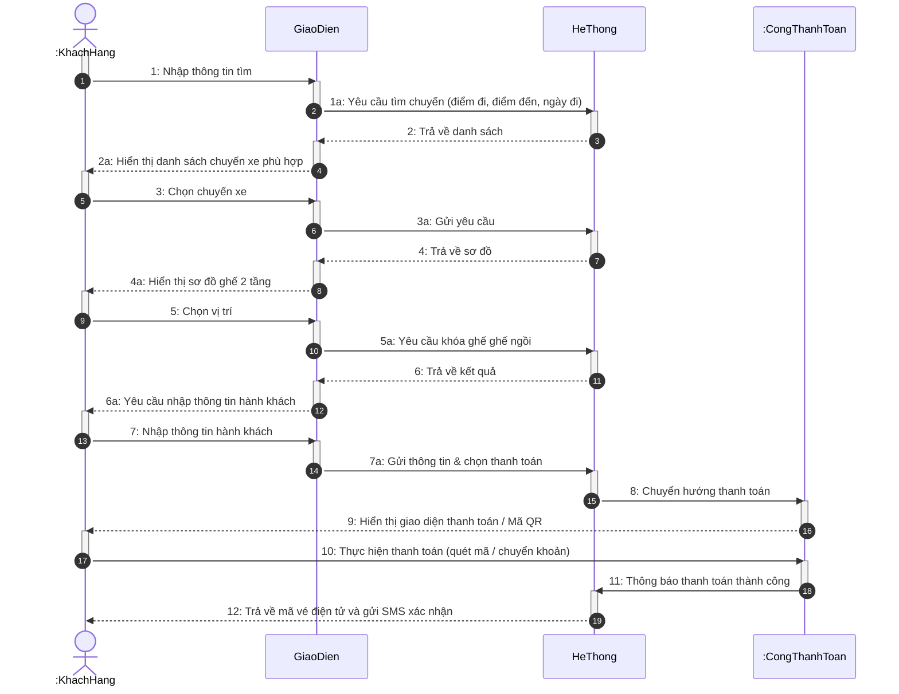

---

### 1.2. Luồng tác nghiệp 2: Bán vé trực tiếp & Thanh toán tại quầy bến xe (Kênh Quầy vé / Nhân viên)
*(Nhân viên bán vé tiếp nhận yêu cầu từ hành khách tại quầy bến xe, tra cứu chuyến, tư vấn vị trí ghế, xác nhận thu tiền mặt hoặc quét VietQR qua hệ thống thanh toán và bàn giao vé cho khách)*

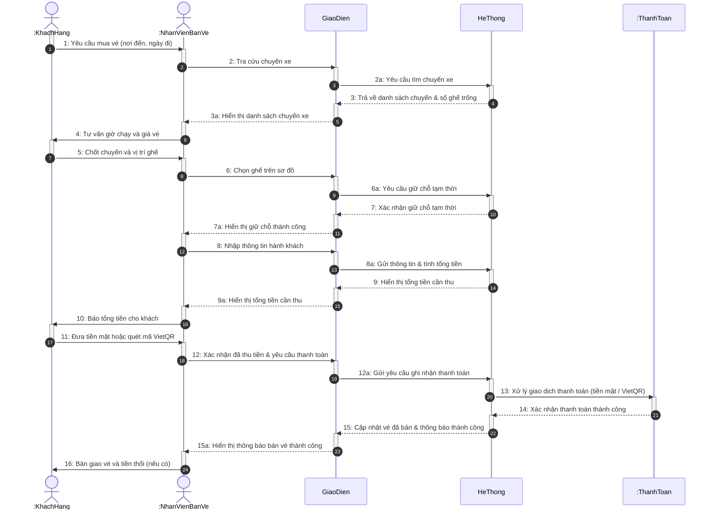

---

## 2. GIAI ĐOẠN 2: BIỂU ĐỒ TUẦN TỰ THIẾT KẾ CHI TIẾT (MÔ HÌNH 3 LỚP BCE)

---

### 2.1. Sơ đồ Tuần tự Chi tiết: Tạm khóa chỗ ngồi (UC02)
- **Ngữ cảnh:** Khách hàng chọn vị trí ghế ngồi trên sơ đồ xe, hệ thống kiểm tra và tạm khóa vị trí ghế trong phiên đặt vé (5 phút), xử lý tình huống ghế còn trống, ghế xung đột và giải phóng ghế khi hết thời gian.
- **Thành phần:**
  - `Boundary`: `:ManHinhChonGhe`
  - `Control`: `:DieuKhienGiuCho`
  - `Entity`: `:Ghe`

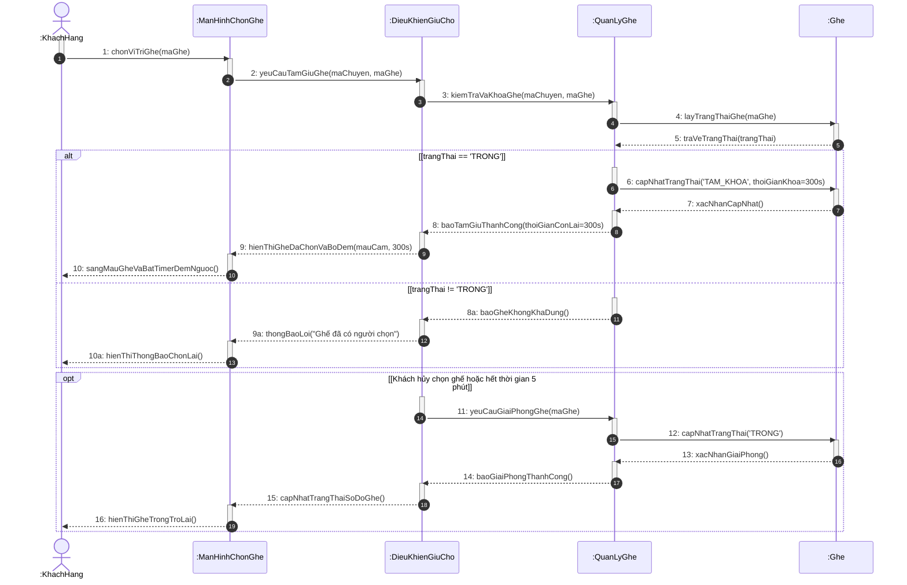

---

### 2.2. Sơ đồ Tuần tự Chi tiết: Xử lý Thanh toán & Xuất vé điện tử
- **Ngữ cảnh:** Cổng thanh toán gửi thông báo webhook kết quả giao dịch, hệ thống đối soát, cập nhật vé chính thức và sinh mã QR.
- **Thành phần:**
  - `Boundary / External`: `:CongThanhToan`
  - `Control`: `:DieuKhienThanhToan`, `:DichVuVe`, `:DichVuThongBao`
  - `Entity`: `:DonDatVe`, `:VeXe`, `:Ghe`
  - `Actor`: `:KhachHang`

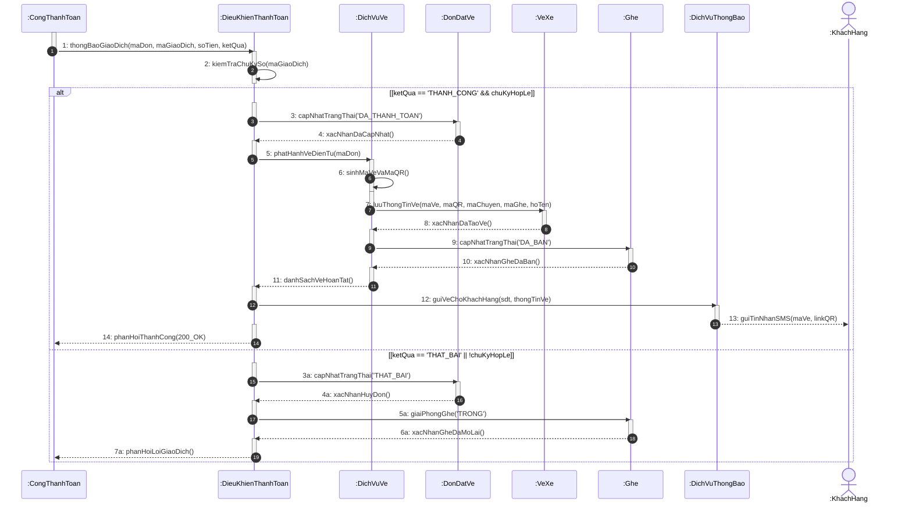

---

### 2.3. Sơ đồ Tuần tự Chi tiết: Đăng ký tài khoản (UC08)
- **Ngữ cảnh:** Người dùng chưa có tài khoản, thực hiện đăng ký bằng cách nhập thông tin và xác thực mã OTP gửi về số điện thoại qua dịch vụ SMS.
- **Thành phần:**
  - `Boundary`: `:ManHinhDangKy`
  - `Control`: `:DieuKhienDangKy`
  - `Entity`: `:TaiKhoan`
  - `External`: `:DichVuSMS`

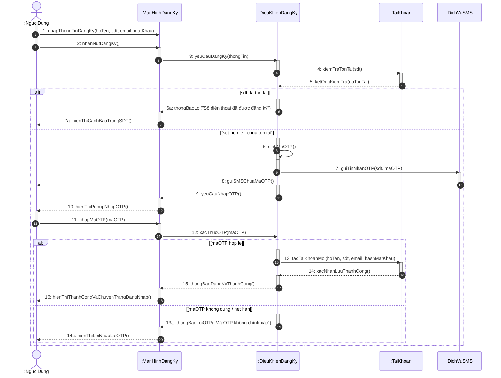

---

### 2.4. Sơ đồ Tuần tự Chi tiết: Đăng nhập Hệ thống (UC09)
- **Ngữ cảnh:** Người dùng đăng nhập vào hệ thống bằng thông tin đăng nhập, hệ thống kiểm tra mật khẩu, trạng thái khóa và khởi tạo phiên làm việc.
- **Thành phần:**
  - `Boundary`: `:ManHinhDangNhap`
  - `Control`: `:DieuKhienDangNhap`
  - `Entity`: `:TaiKhoan`

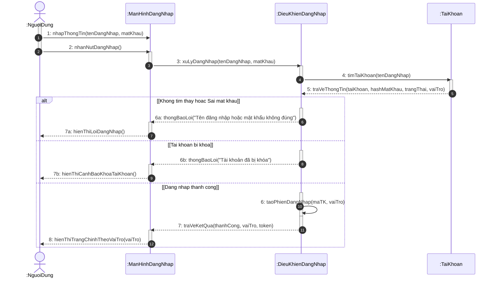

---

### 2.5. Sơ đồ Tuần tự Chi tiết: Tra cứu & Tìm chuyến xe (UC01)
*(Áp dụng mô hình 3 lớp BCE để mô tả quá trình khách hàng nhập thông tin tìm chuyến xe)*

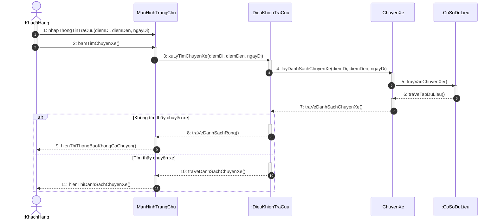

---

### 2.6. Sơ đồ Tuần tự Chi tiết: Hủy vé trực tuyến (UC05)
*(Áp dụng mô hình 3 lớp BCE để mô tả quá trình khách hàng hủy vé qua website/app và được hoàn tiền điện tử)*

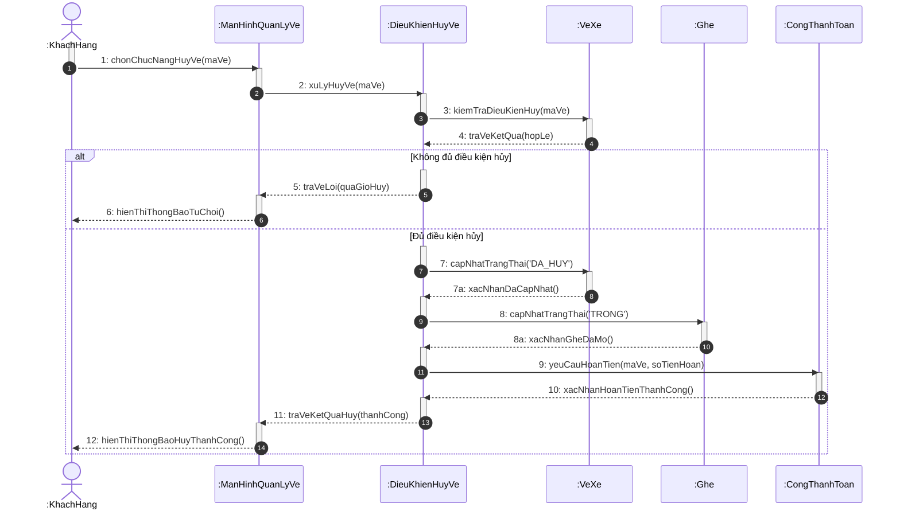

---

### 2.7. Sơ đồ Tuần tự Chi tiết: Hủy vé tại quầy (UC06)
*(Áp dụng mô hình 3 lớp BCE để mô tả nhân viên tra cứu vé, hủy vé, trả tiền và in biên nhận hủy cho khách)*

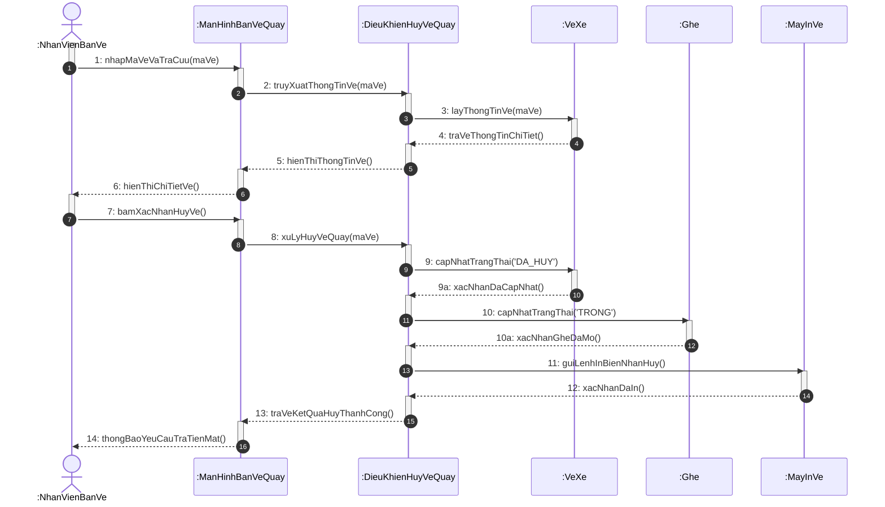

---

### 2.8. Sơ đồ Tuần tự Chi tiết: Khôi phục mật khẩu (UC10)
*(Áp dụng mô hình 3 lớp BCE để mô tả quá trình xác thực OTP qua SMS và cấp lại mật khẩu)*

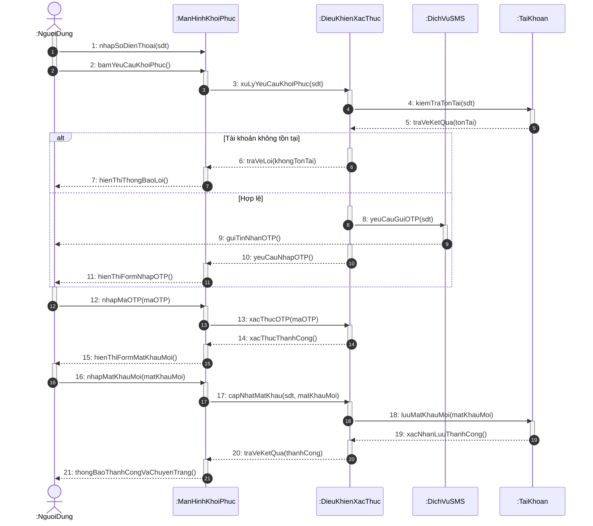

---

### 2.9. Sơ đồ Tuần tự Chi tiết: Lịch sử mua vé (UC07)
*(Khách hàng xem lịch sử vé; luồng mở rộng: lọc theo trạng thái vé)*

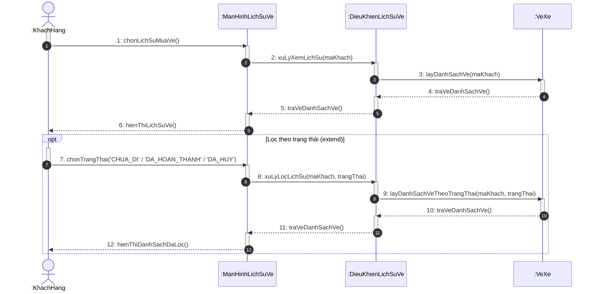

---

### 2.10. Sơ đồ Tuần tự Chi tiết: Quản lý thông tin cá nhân (UC11)
*(Khách hàng / Nhân viên bán vé xem hồ sơ; luồng mở rộng: cập nhật thông tin)*

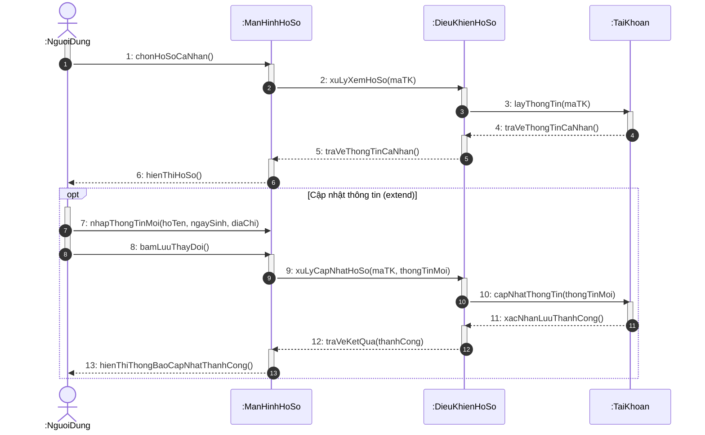

---

### 2.11. Sơ đồ Tuần tự Chi tiết: Đổi mật khẩu (UC12)

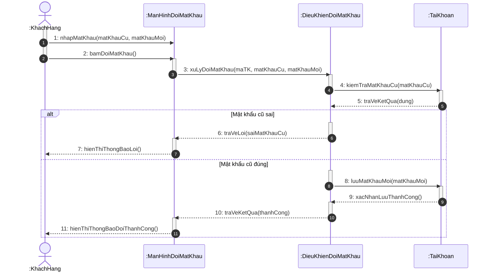

---

### 2.12. Sơ đồ Tuần tự Chi tiết: Quản lý chuyến xe & lịch trình (UC13)
*(Admin xem danh sách, thêm chuyến mới và hủy chuyến kèm hoàn tiền (include). Các thao tác sửa/tìm kiếm tương tự luồng xem/thêm nên không vẽ lặp.)*

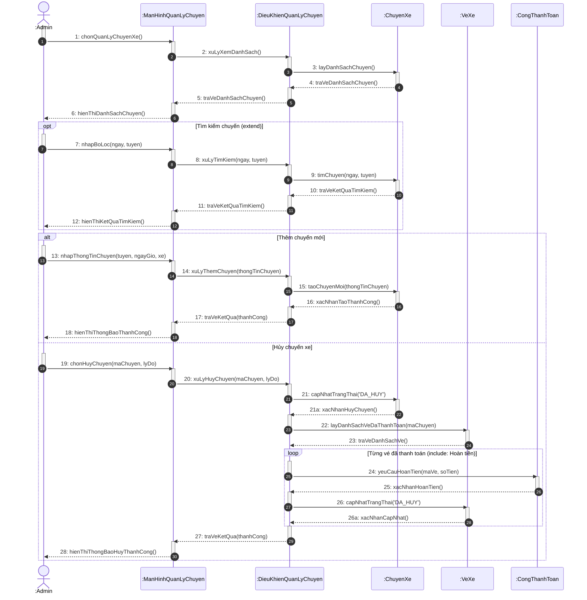

---

### 2.13. Sơ đồ Tuần tự Chi tiết: Quản lý xe & sơ đồ ghế (UC14)
*(Admin xem danh sách xe, thêm xe mới kèm thiết lập sơ đồ ghế (include) và ngừng hoạt động xe)*

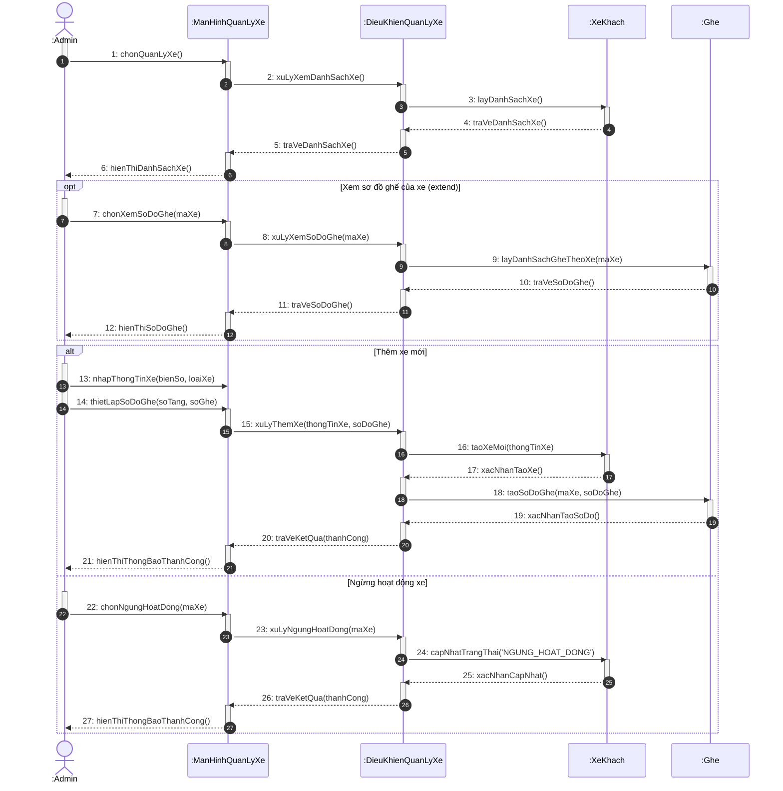

---

### 2.14. Sơ đồ Tuần tự Chi tiết: Quản lý giá vé (UC15a)
- **Ngữ cảnh:** Admin tra cứu danh sách bảng giá vé của các tuyến xe và cập nhật giá vé mới cho từng chuyến.
- **Thành phần:**
  - `Boundary`: `:ManHinhGiaVe`
  - `Control`: `:DieuKhienGiaVe`
  - `Entity`: `:ChuyenXe`

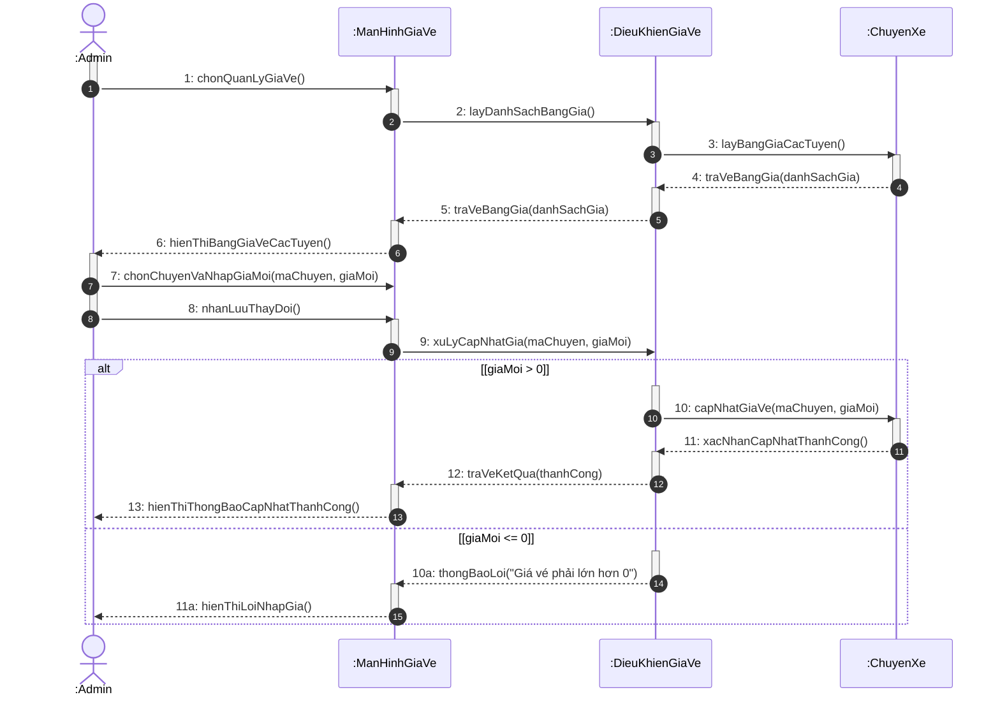

---

### 2.15. Sơ đồ Tuần tự Chi tiết: Quản lý khuyến mãi (UC15b)
- **Ngữ cảnh:** Admin xem danh sách mã giảm giá, thêm mã khuyến mãi mới hoặc bật/tắt (kích hoạt/hủy kích hoạt) mã giảm giá.
- **Thành phần:**
  - `Boundary`: `:ManHinhKhuyenMai`
  - `Control`: `:DieuKhienKhuyenMai`
  - `Entity`: `:MaGiamGia`

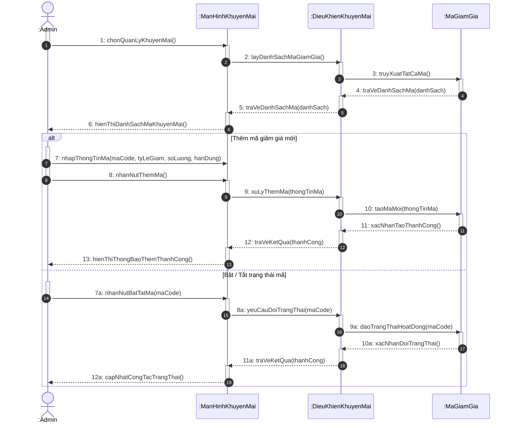

---

### 2.16. Sơ đồ Tuần tự Chi tiết: Quản lý tài khoản & phân quyền (UC16)
*(Admin xem danh sách, tạo tài khoản nhân viên kèm phân quyền (include) và khóa/mở khóa tài khoản)*

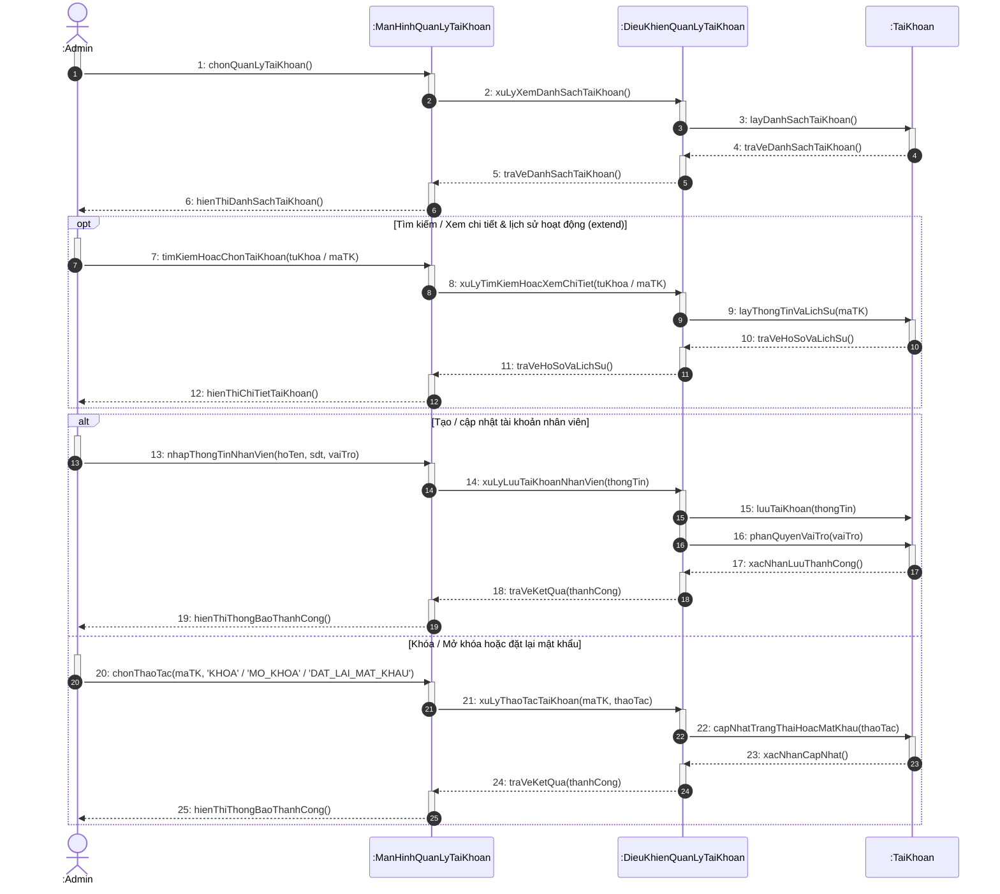

---

### 2.17. Sơ đồ Tuần tự Chi tiết: Thống kê & báo cáo doanh thu (UC17)
*(Admin xem Dashboard thống kê; luồng mở rộng: lọc theo thời gian và xuất báo cáo)*

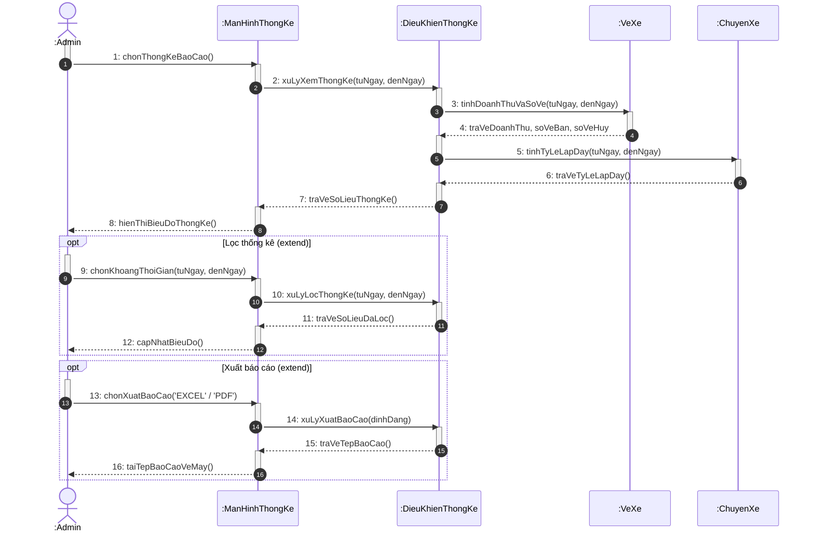

---

## 3. BẢNG TỔNG KẾT ÁNH XẠ THÔNG ĐIỆP

| Tác nhân / Lớp gửi | Lớp nhận | Thông điệp / Thao tác Tiếng Việt | Vùng hoạt động (Activation) | Ý nghĩa nghiệp vụ |
| :--- | :--- | :--- | :--- | :--- |
| `:KhachHang` | `:ManHinhChonGhe` | `chonViTriGhe(maGhe)` | `:KhachHang` kích hoạt $\rightarrow$ đóng khi gửi | Khách nhấn vào ghế còn trống trên sơ đồ xe |
| `:ManHinhChonGhe` | `:DieuKhienDatVe` | `yeuCauTamGiuGhe(maChuyen, maGhe)` | `:ManHinhChonGhe` kích hoạt xử lý giao diện | Giao diện gửi yêu cầu giữ chỗ xuống tầng điều khiển |
| `:DieuKhienDatVe` | `:QuanLyGhe` | `kiemTraVaKhoaGhe(maChuyen, maGhe)` | `:DieuKhienDatVe` điều phối nghiệp vụ | Tầng nghiệp vụ điều phối kiểm tra và tạm khóa ghế |
| `:QuanLyGhe` | `:Ghe` | `capNhatTrangThai('TAM_KHOA')` | `:QuanLyGhe` & `:Ghe` kích hoạt cập nhật trạng thái | Đổi trạng thái thực thể Ghế để tránh người khác đặt trùng |
| `:DieuKhienDatVe` | `:DonDatVe` | `khoiTaoDon(maKhach, tongTien)` | `:DonDatVe` kích hoạt tạo bản ghi mới | Khởi tạo đơn đặt vé ở trạng thái chờ thanh toán |
| `:CongThanhToan` | `:DieuKhienThanhToan` | `thongBaoGiaoDich(maDon, ketQua)` | `:CongThanhToan` kích hoạt gửi webhook | Cổng thanh toán phản hồi kết quả trừ tiền |
| `:DieuKhienThanhToan`| `:DichVuVe` | `phatHanhVeDienTu(maDon)` | `:DieuKhienThanhToan` điều phối xuất vé | Kích hoạt quy trình xuất vé khi thanh toán thành công |
| `:DichVuVe` | `:VeXe` | `luuThongTinVe(maVe, maQR, ...)` | `:VeXe` kích hoạt lưu trữ bản ghi vé | Lưu thực thể vé điện tử hoàn chỉnh vào hệ thống |
| `:DieuKhienThanhToan`| `:Ghe` | `giaiPhongGhe('TRONG')` | `:Ghe` kích hoạt mở khóa lại | Mở lại ghế trống nếu thanh toán thất bại hoặc hủy đơn |
| `:NhanVienBanVe` | `:ManHinhBanVeQuay` | `traCuuChuyen(diemDi, diemDen, ngayDi)` | `:NhanVienBanVe` kích hoạt thao tác quầy | Nhân viên nhập thông tin hành trình theo yêu cầu khách |
| `:ManHinhBanVeQuay` | `:DieuKhienBanVeQuay` | `xuLyXuatVeTaiQuay(maNV, ...)` | `:ManHinhBanVeQuay` gửi lệnh xử lý | Giao diện quầy chuyển dữ liệu thanh toán xuống tầng nghiệp vụ |
| `:DieuKhienBanVeQuay` | `:HoaDonBanVe` | `taoHoaDon(maNV, tongTien, ...)` | `:HoaDonBanVe` ghi nhận hóa đơn quầy | Lưu thông tin thanh toán tiền mặt/VietQR gắn với mã nhân viên |
| `:DieuKhienBanVeQuay` | `:MayInVe` | `guiLenhInPhieuVe(maVe, maQR, ...)` | `:MayInVe` kích hoạt máy in nhiệt | Tự động in vé giấy vật lý trao cho khách tại quầy |
| `:NguoiDung` | `:ManHinhDangKy` | `nhapThongTinDangKy(hoTen, sdt, ...)` | `:NguoiDung` kích hoạt nhập thông tin | Khách hàng điền thông tin form để đăng ký tài khoản mới |
| `:DieuKhienXacThuc` | `:DichVuSMS` | `yeuCauGuiOTP(sdt)` | `:DichVuSMS` kích hoạt gửi OTP | Yêu cầu bên thứ 3 gửi tin nhắn mã xác thực cho Khách hàng |
| `:NguoiDung` | `:ManHinhDangKy` | `nhapMaOTP(maOTP)` | `:NguoiDung` kích hoạt nhập OTP | Khách hàng nhập mã OTP để xác nhận đăng ký tài khoản |
| `:DieuKhienXacThuc` | `:TaiKhoan` | `luuTaiKhoanMoi(sdt, matKhauBam, ...)` | `:TaiKhoan` kích hoạt tạo tài khoản | Hệ thống lưu trữ thông tin tài khoản thành viên mới sau khi xác thực |
| `:ManHinhDangKy` | `:ManHinhDangNhap` | `chuyenVeTrangDangNhap()` | Chuyển hướng giao diện | Tự động đưa người dùng về lại trang đăng nhập sau khi tạo xong |


